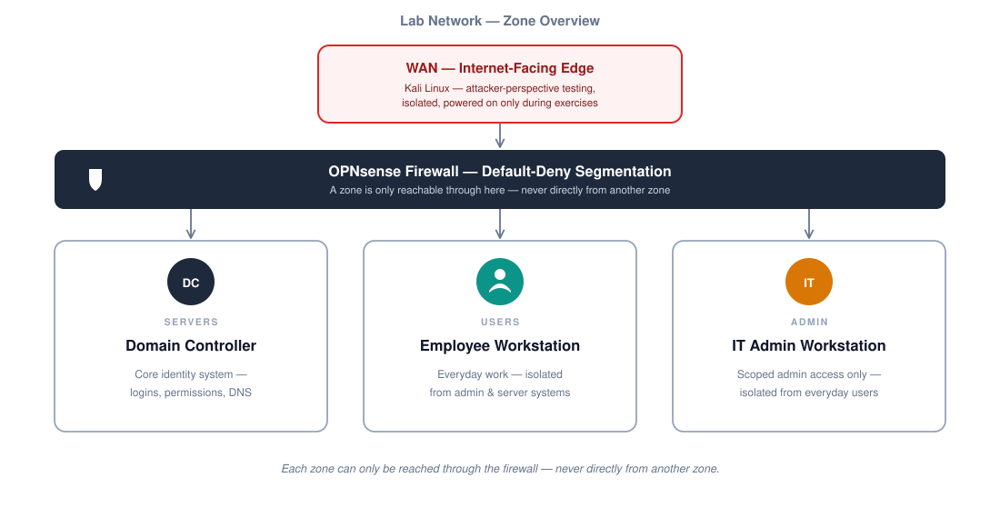
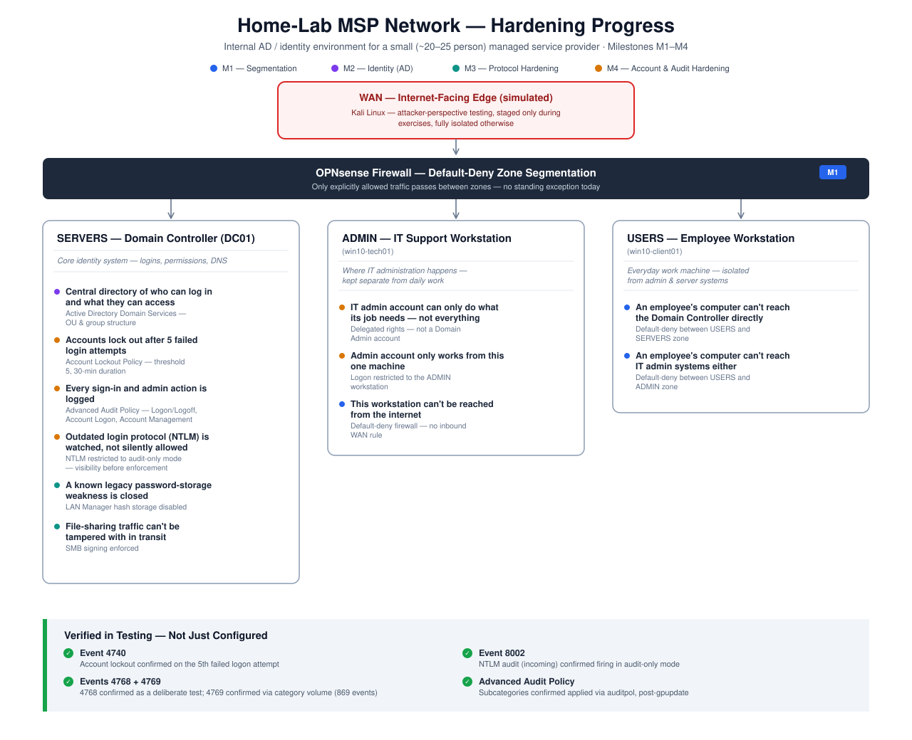

<h1 align="center"></h1>

**[📋 Milestones](#-milestones) · [🗺️ Topology](#-the-lab-today) · [⚔️ Latest attack pass](network-security/milestones/M2-baseline-attacks.md) · [🔒 Scope & safety](#-scope--safety)**

---

## 👋 What this is

I put a firewall in front of an Active Directory network, split it into security zones, and now I attack and defend it — on purpose, in public. Every milestone gets its own write-up: what was built, a test matrix, what broke, how I fixed it, and what I actually learned.

> [!NOTE]
> This is a build log, not a tutorial. Mistakes are left in on purpose — the failures are as much the point as the wins.

## 👤 About

Hi, I'm **Aviv**. I'm building this lab to get real, hands-on experience in network
security — segmenting a network, attacking my own build, and hardening it based on what
the attacks find — while I get started in the field.

📎 [LinkedIn](https://www.linkedin.com/in/aviv-fransia-255905328/)

## 📊 At a glance

| | |
|---|---|
| 🧱 **Stack** | OPNsense · Active Directory (Windows Server 2022) · Windows 10 · Kali Linux · Oracle VirtualBox |
| 🗺️ **Shape** | 1 firewall · 3 internal zones (SERVERS / USERS / ADMIN) · 1 WAN where the attacker sits |
| 📈 **Progress** | `██████████░░░░░░░░░░` 4 / 8 milestones done |
| 📝 **Format** | One write-up per milestone — build, test matrix, failures/fixes, lessons learned |
| 🔒 **Scope** | Fully isolated in VirtualBox — every attack and defense targets this lab only |

## 🏁 Milestones

| | Milestone | Covers | Status |
|---|---|---|---|
| 🧩 | [**M1 — Segmented network**](network-security/milestones/M1-segmented-network.md) | OPNsense firewall, three zones, routing, DHCP relay | ✅ Done |
| ⚔️ | [**M2 — Baseline attack pass**](network-security/milestones/M2-baseline-attacks.md) | Attack the allow-all network, record what succeeds | ✅ Done |
| 🧱 | [**M3 — Network hardening**](network-security/milestones/M3-hardening.md) | Default-deny + explicit AD allow rules, mgmt GUI from ADMIN only, GPO hardening | ✅ Done |
| 🔐 | [**M4 — Account & audit hardening**](network-security/milestones/M4-ad-hardening.md) | Lockout policy, admin separation, NTLM audit-only, detection-oriented audit logging | ✅ Done |
| 👁️ | **M5 — Detection** | One free, open-source detection system | ⬜ Planned |
| 🔁 | **M6 — Attack & defend** | Re-run M2's attacks + privilege escalation, before/after comparison | ⬜ Planned |
| 🚫 | **M7 — Zero Trust** | Least privilege per user/app, no implicit trust between zones | ⬜ Planned |
| 📦 | **M8 — Packaging** | Final README, diagram, lessons learned | ⬜ Planned |

*Planned milestones link here once they have content.*

## 🗺️ The lab today

<strong>How it fits together</strong>

 

The domain controller (AD, DNS, DHCP) lives in SERVERS. Workstations in USERS and ADMIN get their addresses from it through a DHCP relay on the firewall — OPNsense's own DHCP server is off. The lab reuses an earlier Windows domain lab of mine as the SERVERS zone.

The diagram above shows the current design. In M1 the inter-zone rules were allow-all; **M3** replaced that with default-deny plus explicit allow rules, informed directly by what M2's attack pass found open. **M4** then hardened accounts and auditing inside the domain:

| Zone | Host |
|---|---|
| WAN | Kali — attacker, outside scenarios |
| SERVERS | `win2k22-DC01` — AD DS · DNS · DHCP · `lab.local` |
| USERS | `win10-client01` — employee workstation, domain-joined |
| ADMIN | `win10-tech01` — technician workstation, domain-joined |

## 🔒 Scope & safety

> [!IMPORTANT]
> Everything runs inside VirtualBox, isolated from my home network. Every attack and defense exercise in this repo targets only machines inside this lab.

---

🧱 *Building it, breaking it, writing down what happens either way.*

