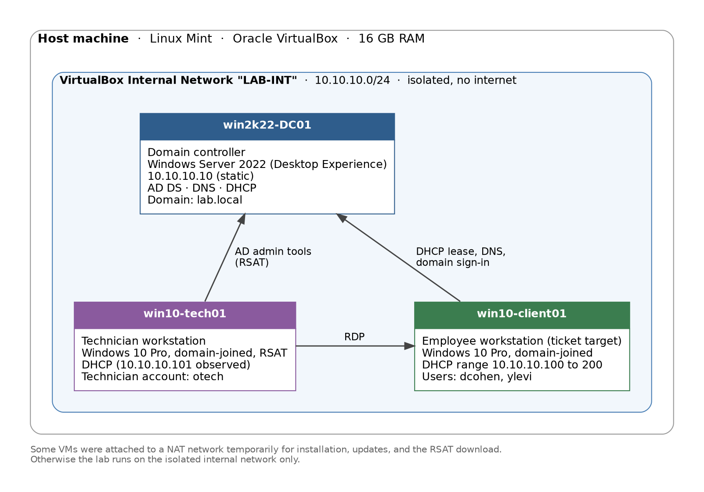

# My Home Lab
I learn best by doing. So I started by building a Windows domain at home, broke it in realistic ways, and then worked out how to fix it. Some things went wrong along the way, and those parts are in here too, because that's where I learned the most. This lab is meant to grow with me over the years, into new areas.
## About me
Hi! I'm learning IT hands-on, one lab at a time. This repository is my notebook: a small domain I built myself, the things I broke on purpose, and what I found out when I fixed them. I'll keep adding to it as I try new things.

## The lab today

Three virtual machines on an isolated network: a domain controller (Active Directory, DNS, DHCP), an employee workstation where the tickets happen, and a technician workstation used to work them. This diagram grows as the lab does. More detail is on the [infrastructure](docs/infrastructure.md) page.

## Areas

Pick an area. Each area has its own page that groups its scenarios by topic, and every scenario has a full write-up with screenshots.

| Area | What's inside | Scenarios |
|---|---|---|
| [Windows domain](windows-domain/README.md) | Active Directory, DHCP, DNS, Group Policy, file permissions, delegated administration | 7 |

### Planned

These areas are not started yet. They will be added here as I work on them.

- Networking: network configuration
- Cloud: cloud configuration
- Security operations: investigating cyber incidents
- Zero Trust: deploying ZTNA
- AI
- ...and more
