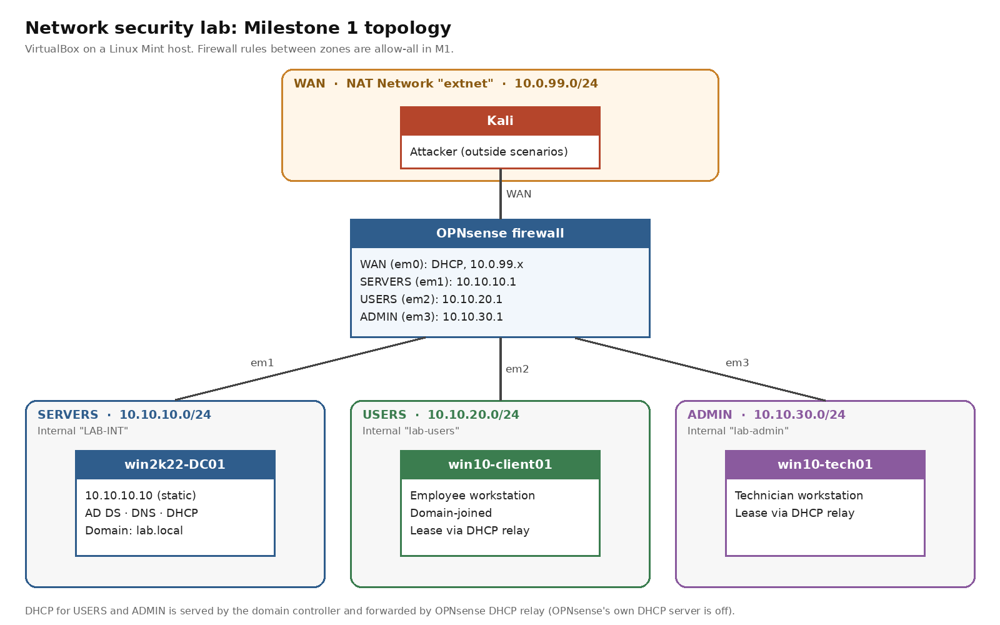

[Home](../../README.md) · [Network security](../README.md)

# Milestone 1: Segmented Network

## Goal

Split a flat, single-subnet Active Directory lab into three security zones — SERVERS, USERS, and ADMIN — enforced by a dedicated OPNsense firewall, with routing and DHCP working correctly across all zones.

This lab builds on an earlier Active Directory home lab (domain controller, DNS, DHCP, one user workstation, one technician workstation), rather than starting from a blank network. That earlier environment is reused here as the SERVERS zone, which saved rebuilding AD from scratch but also meant the domain controller needed real reconfiguration (new routes, new DHCP scopes) — it was not the "zero reconfiguration" assumption I started with.

## Topology

| Zone | Subnet | Gateway (OPNsense) | Machines |
|---|---|---|---|
| WAN | 10.0.99.0/24 | — (NAT) | Kali (outside-attacker scenarios) |
| SERVERS | 10.10.10.0/24 | 10.10.10.1 | Domain Controller (DNS, DHCP, AD DS) |
| USERS | 10.10.20.0/24 | 10.10.20.1 | User workstation |
| ADMIN | 10.10.30.0/24 | 10.10.30.1 | Technician workstation |

OPNsense sits at the center with one NIC per zone, enforcing routing and (eventually) firewall policy between them. For this milestone, firewall rules are allow-all between zones — default-deny with explicit AD-port allow rules is applied in Milestone 3, after a baseline attack pass (Milestone 2) establishes what an unsegmented/unfiltered network exposes.

## Why DHCP relay was required

The domain controller's DHCP server lives on the SERVERS subnet, but DHCP relies on broadcast traffic, which doesn't cross a subnet boundary on its own — firewall rules don't change that. Each new OPNsense interface (USERS, ADMIN) needed a DHCP Relay Agent configured, forwarding broadcast requests to the DC as a unicast request. Without it, clients on the new subnets receive no DHCP response at all and fall back to a self-assigned (APIPA) address, even when routing and firewall rules are otherwise correct.

## Test matrix

| Test | Expected | Actual | Result |
|---|---|---|---|
| OPNsense interfaces addressed (LAN/OPT1/OPT2/WAN) | All four interfaces reachable at their planned addresses | Matched exactly | Pass |
| DHCP relay delivers a lease on USERS | Client receives an address in 10.10.20.0/24 | Received correctly via relay | Pass |
| DHCP relay delivers a lease on ADMIN | Technician workstation receives an address in 10.10.30.0/24 | Received correctly via relay | Pass |
| Domain logon from the USERS subnet | Domain user authenticates successfully | Initially failed — see Failure 1 | Pass after fix |
| ADMIN subnet reaches the domain controller | Ping to the DC succeeds | Initially failed — see Failure 2 | Pass after fix |

## Failures and fixes

**1. No firewall rules on newly added interfaces.**
OPNsense automatically creates a default-allow rule on the LAN interface, but interfaces added afterward (OPT1/OPT2, used here for USERS and ADMIN) start with no rules at all. The result was a fully correct IP address and DNS configuration, but all traffic silently dropped — which surfaced as a generic "domain isn't available" error that initially looked like a credentials problem rather than a network one. Fixed by adding temporary allow-all rules on both new interfaces, consistent with the plan's own milestone order (a baseline pass with open rules, before default-deny is introduced later).

**2. Missing DHCP Router option on one new scope.**
The ADMIN-zone DHCP scope was created with the DNS server and domain name options set, but the Router option was missed. The client received a valid lease and could resolve DNS, but had no default gateway — `ipconfig` showed a blank gateway field, and pings failed immediately with a local routing error rather than a timeout. Fixed by adding the missing Router option to the scope and renewing the client's lease.

**3. Stale client state after a firewall interface change.**
After the firewall's LAN interface was readdressed, a workstation that had already been running kept failing domain logon in a way that looked like an account or password problem, even after confirming the account itself was fine. A reboot of the workstation resolved it immediately. Lesson: a client's network stack can hold onto stale state after a host-side interface change on the firewall side, even when the client's own configuration hasn't changed — renewing the IP lease or rebooting the client is worth trying early, not as a last resort.

## What I learned

Segmentation looks simple on a diagram — three boxes and a firewall — but almost everything that actually breaks it lives in the details that don't show up on the diagram at all: a missing DHCP option, a firewall interface with no rules yet, a client that needs a nudge to notice its own network changed. Each of this milestone's three failures had a symptom that pointed somewhere else at first (a login problem, a password problem), and the only way through was to isolate layer by layer — confirm DHCP worked before blaming the firewall, confirm the firewall before blaming AD. That diagnostic discipline, more than any single fix, is the actual skill this milestone built.

## Scope statement

This lab runs entirely inside VirtualBox and is isolated from my home network: there is no bridged connection to any physical network, and the host does not route between the lab and the home LAN. The only path out is the WAN side, a VirtualBox NAT Network that gives the firewall outbound access. Nothing on the home network can reach the lab. All attack and defense testing in later milestones targets only machines inside this lab.

---

[Back to the Network security page](../README.md) · [Next: Milestone 2: Baseline Attack Pass →](M2-baseline-attacks.md)
