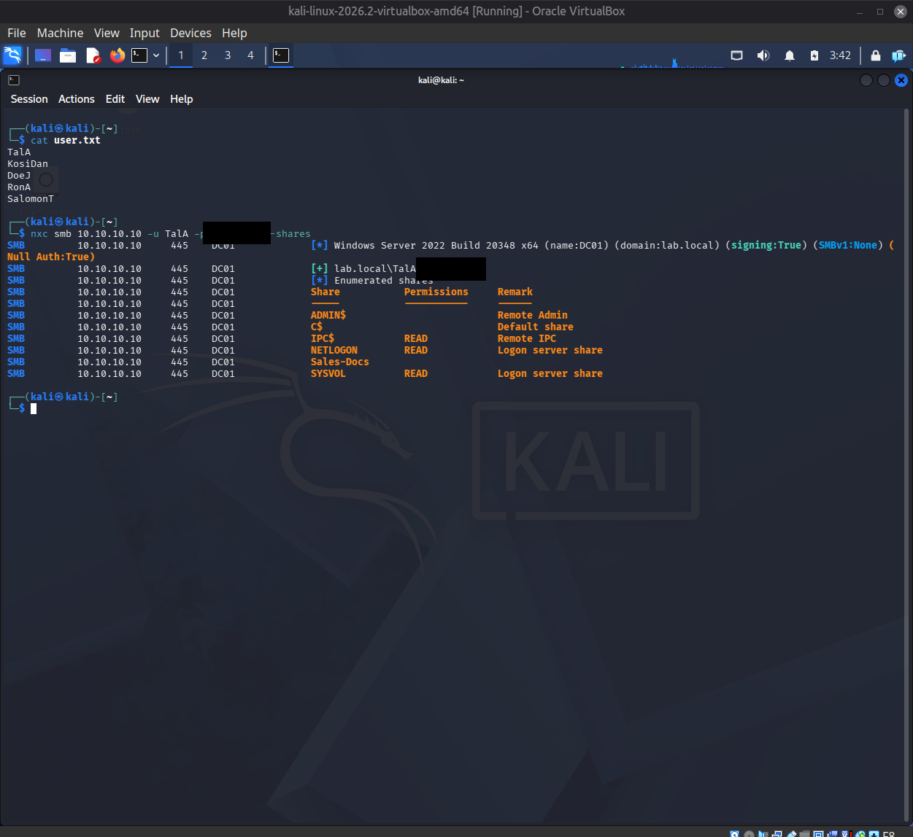
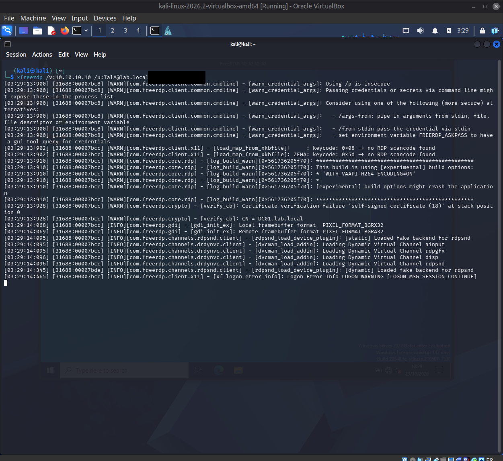
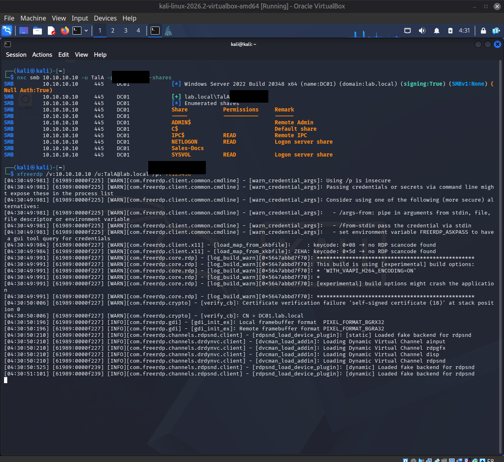
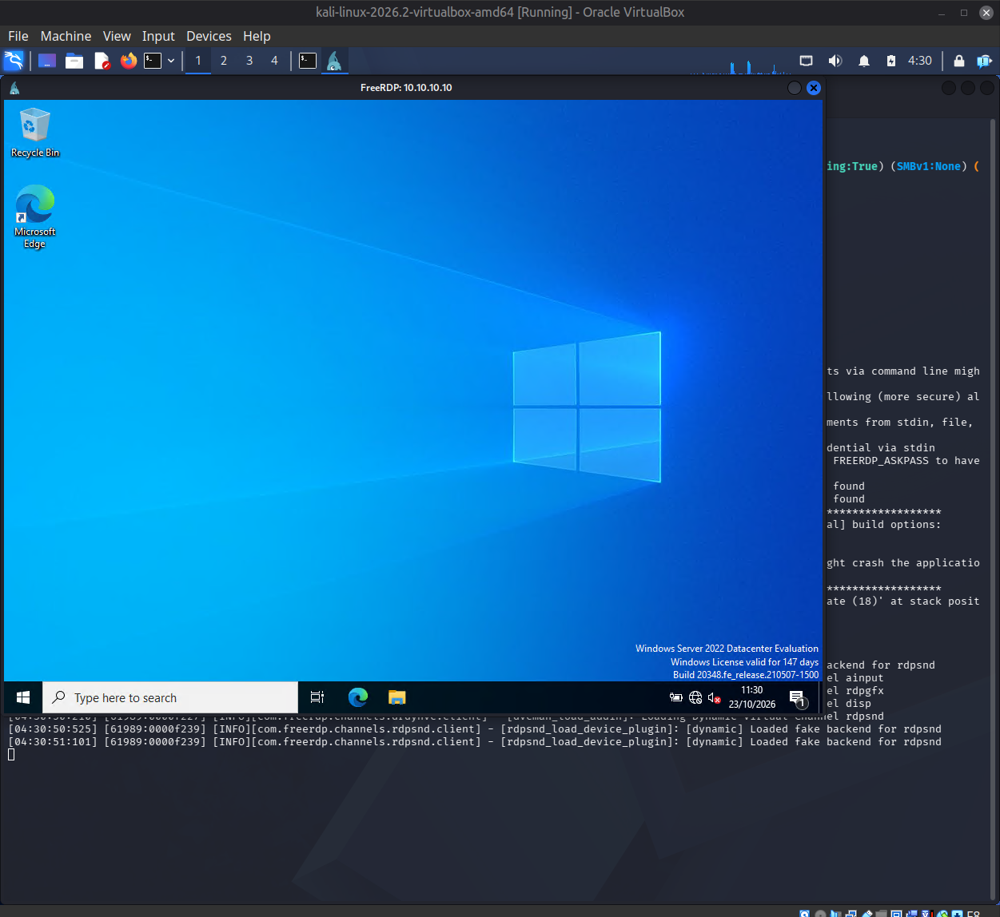
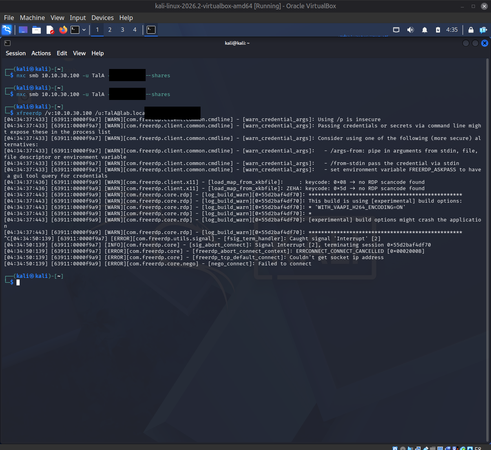
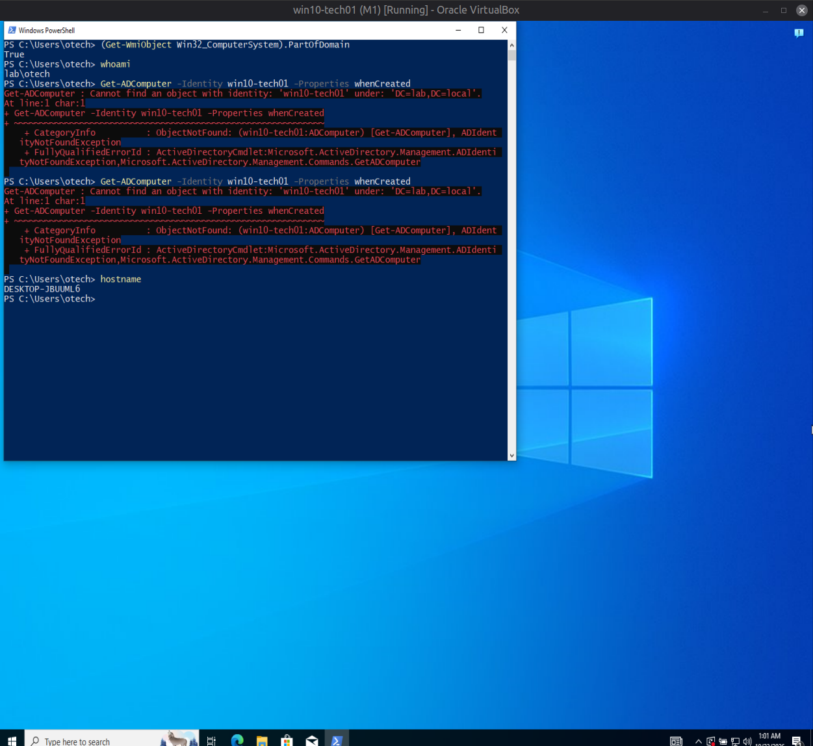
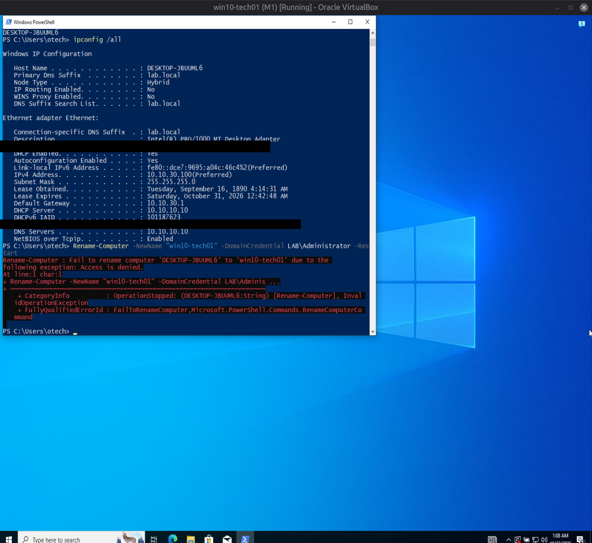
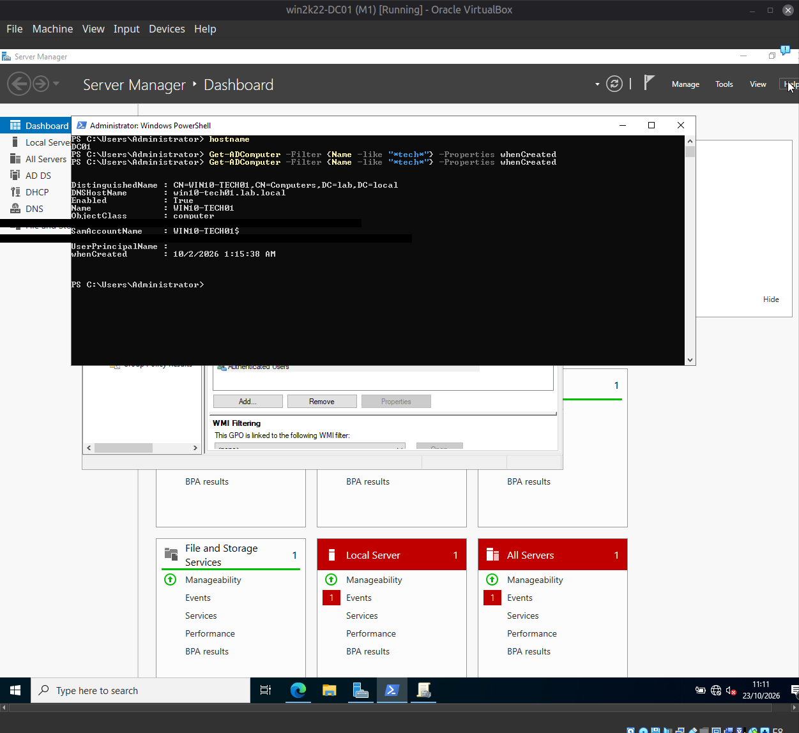
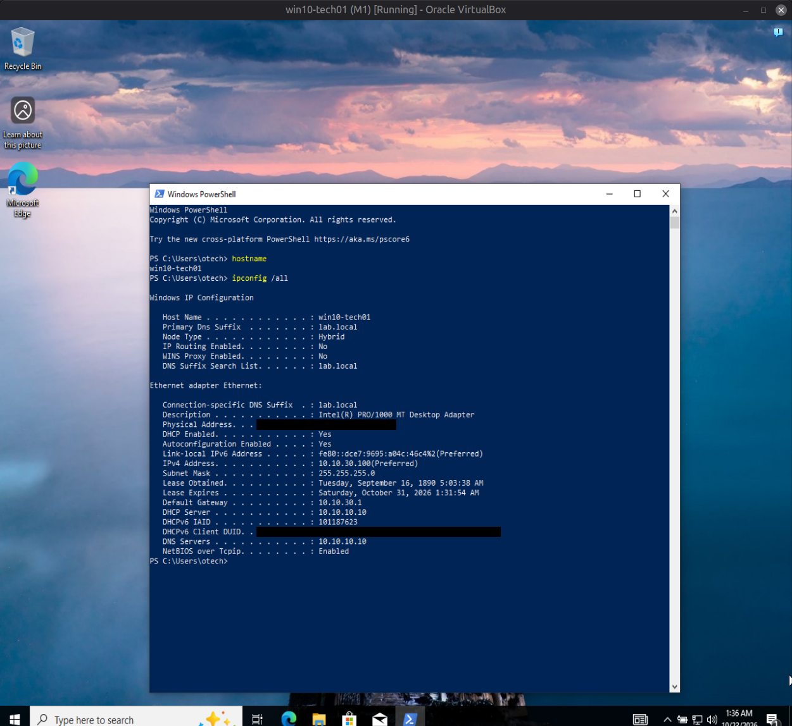

[Home](../../README.md) · [Network security](../README.md)

# Milestone 2: Baseline Attack Pass

**Date:** 2026-10-22 – 2026-10-23
**Network state:** M1 segmented network (OPNsense, four zones — WAN/SERVERS/USERS/ADMIN), OPT1/OPT2 temporary allow-all rules still in place, WAN default-deny (never had an allow rule). No hardening applied yet — this is the "before" baseline M6 will later compare against.

## Goal

Attack the network as it exists today — before M3's default-deny policy and hardening — and document what succeeds. Every attack below was executed from Kali, positioned either outside the network (`extnet`, representing an external attacker) or inside the USERS zone (representing a compromised regular workstation/user).

## Attack List Order — Methodology Note

Attacks were executed in a pre-defined A1→A7 testing order (network scan → authentication attacks → lateral movement/privilege escalation → enumeration), chosen to test each network layer independently. **This is not the order a real attacker would use.** A7 (AD enumeration) in particular would normally run immediately after gaining any foothold, since it directly informs which accounts to target for spraying (A3) and reveals Kerberoastable service accounts (A6) before they'd otherwise need to be set up as a known prerequisite. A realistic chain would be: A1 (external recon) → foothold → A7 (enumeration) → A6 (exploit discovered SPN) → A3 (targeted spray using enumerated usernames) → A5 (lateral movement with obtained credentials) → A2/A4 (opportunistic, parallel). This reordering is recommended for any future re-test (e.g., M6).

## Results Summary

| # | Attack | Position | Result |
|---|--------|----------|--------|
| A1 | Port/service scan | Outside (WAN) + Inside (USERS→SERVERS) | Outside: 1000/1000 TCP + top-20 UDP filtered, zero exposure. Inside: 11 AD ports open (53, 88, 135, 139, 389, 445, 464, 636, 3268, 3269, 3389) under allow-all. |
| A2 | GUI brute force | WAN + USERS | Reconnaissance only — found management GUI (443) reachable from **both** WAN and USERS, caused by OPNsense's "Listen Interfaces: All" setting operating independently of the firewall ruleset (WAN's rule table was empty/default-deny, yet GUI was still reachable). Live brute-force attempt deferred to M3 before/after. |
| A3 | Password spray | Inside (USERS→SERVERS) | SMB: hydra failed (tool/SMB2+ incompatibility), nxc succeeded. RDP: confirmed credentials valid but denied — first due to no RDP rights, then revealed that DC-level RDP rights require a GPO edit (Default Domain Controllers Policy), not just local group membership. Account lockout (threshold 3) confirmed working, including an unintended real lockout from cumulative attempts across tools. |
| A4 | LLMNR/NBT-NS poisoning + SMB relay | N/A (not executed) | GPO check only: "Turn off multicast name resolution" = **Not Configured**, meaning LLMNR remains enabled (Windows default) — confirmed vulnerable. Live poisoning/relay was deliberately not executed (active MITM technique). SMB signing also confirmed inconsistent: DC enforces signing, `win10-tech01` does not — the latter would be relay-viable if this attack were carried out. |
| A5 | Lateral movement | USERS→SERVERS, USERS→ADMIN | SERVERS: full SMB share access + RDP session, both successful. ADMIN: blocked for over an hour by Windows Firewall default-deny on `win10-tech01` (not a network/zone control — SMB and RDP were both silently dropped at the host). Root cause found and fixed (File and Printer Sharing + Remote Desktop firewall rule groups were disabled). SMB succeeded fully after the fix (share enumeration, `IPC$` read confirmed; `C$`/`ADMIN$` visible but access not demonstrated). RDP remained blocked by an unresolved FreeRDP-vs-Windows RDP stack compatibility issue even after the firewall fix, local Remote Desktop Users group confirmed correct, and `TermService` restart — documented as a tooling limitation, not a security finding. |
| A6 | Kerberoasting | Inside, as low-privilege user | Full success. SPN registered on a purpose-built service account; TGS ticket requested and captured by an ordinary domain user with no special rights (`impacket-GetUserSPNs`). Password cracked offline with John the Ripper using a small targeted wordlist (instant). Full `rockyou.txt` (14M+ entries, 2009-era corpus) found nothing — the password's current-year pattern couldn't exist in a 17-year-old leak list, a useful demonstration of targeted vs. generic wordlists. hashcat could not complete on this VM (OpenCL/`pocl` memory allocation limitation, unrelated to wordlist size or technique). |
| A7 | AD enumeration | Inside, as low-privilege user | Full domain enumeration achieved with a single low-privilege credential: complete user list with logon/password timestamps (including stale, never-logged-in accounts), full AD group structure with membership counts, and a direct, surgical confirmation via raw LDAP query that exactly **one** account (`Administrator`) holds Domain Admin rights. |

## Evidence (Screenshots)

Screenshots below are cropped to VM content only (chat/host desktop removed) and redacted — plaintext passwords, MAC addresses, and the AD computer object's SID/GUID are blacked out. Domain usernames are left visible since they're already named in the tables above.

### A3 — Password spray

*`nxc smb` authenticating as `TalA` and enumerating shares on `DC01` — password redacted.*

### A5 — Lateral movement

*Initial `xfreerdp` attempt to `10.10.10.10` — logs a LOGON_WARNING; password redacted.*

*SMB share access confirmed, then `xfreerdp` session negotiation proceeding against the DC.*

*Full RDP session reached the Windows desktop — SERVERS-zone lateral movement confirmed.*

*`Couldn't get socket ip address` / `Failed to connect` — a connection failure, not an auth denial, pointing at the host being unreachable rather than a credentials problem. Investigating this surfaced two latent issues: `win10-tech01`'s real Windows hostname was `DESKTOP-JBUUML6` (no matching AD object existed under the expected name), and it had no inbound firewall exceptions enabled by default. Both are detailed in "Failures Found and Fixed" below rather than screenshot-by-screenshot here.*

*`hostname` returns `DESKTOP-JBUUML6` — the VM's real Windows identity, the root cause behind the connection failure above.*

*Full `ipconfig /all` (MAC redacted) followed by `Rename-Computer -DomainCredential LAB\Administrator` failing with Access Denied.*

*After the rename succeeded, `Get-ADComputer -Identity win10-tech01` resolves correctly from the DC (SID/ObjectGUID redacted).*

*`hostname` now returns `win10-tech01`; `ipconfig /all` confirms `10.10.30.100` (MAC redacted) — the ADMIN-zone target is finally in the expected state for the SMB evidence captured above.*

## MITRE ATT&CK Mapping

| # | Attack | Technique | ID |
|---|--------|-----------|-----|
| A1 | Port/service scan | Network Service Discovery | T1046 |
| A2 | GUI brute force (recon) | Active Scanning: Vulnerability Scanning | T1595.002 |
| A3 | Password spray | Brute Force: Password Spraying | T1110.003 |
| A4 | LLMNR/NBT-NS poisoning | Adversary-in-the-Middle: LLMNR/NBT-NS Poisoning and SMB Relay | T1557.001 |
| A5 | Lateral movement (SMB/RDP) | Remote Services: SMB/Windows Admin Shares, Remote Desktop Protocol | T1021.002, T1021.001 |
| A6 | Kerberoasting | Steal or Forge Kerberos Tickets: Kerberoasting | T1558.003 |
| A7 | AD enumeration | Account Discovery: Domain Account, Permission Groups Discovery | T1087.002, T1069.002 |

## Failures Found and Fixed (this session)

1. **Kali's NIC was on a leftover `LAB-NAT` network**, not actually connected to the lab at all — contradicted earlier documentation claiming it was unused. Corrected: reattached to `extnet`.
2. **OPNsense WAN interface's "Block private networks" setting** was briefly suspected as a gate for A1; confirmed already correctly disabled (RFC1918 WAN is intentional here).
3. **A VM identity mismatch**: the VM labeled `win10-tech01` had the real Windows hostname `DESKTOP-JBUUML6` and was already domain-joined (since 2026-10-02), contradicting every prior handoff document. Root cause not determined — predates recent sessions. Resolved: formally adopted as domain-joined (resolving a previously open design question), renamed to `win10-tech01` to match documentation.
4. **Windows Firewall on `win10-tech01`** blocked all inbound traffic by default (ICMP, SMB, RDP) — a fresh domain-joined Windows 10 host has no inbound exceptions enabled without explicit configuration. This was the true root cause of over an hour of apparent "network" and "credential" failures during A5. Fixed by enabling the File and Printer Sharing and Remote Desktop firewall rule groups.
5. **RDP to `win10-tech01` remained unreliable** after the firewall fix — multiple FreeRDP security-layer options (`/sec:nla`, `/sec:rdp`), a `TermService` restart, and local rights verification all failed to resolve a persistent post-TLS connection reset. Documented as an open tooling limitation; SMB evidence was used instead for A5's ADMIN-zone finding.
6. **hashcat could not run** on this Kali VM due to an OpenCL/`pocl` CPU-backend memory allocation ceiling, independent of wordlist size. Resolved by using John the Ripper (CPU-native, no OpenCL dependency) instead.

## What I Learned

This session's biggest lesson wasn't about any single attack technique — it was about **diagnostic discipline under a layered, interacting system**. Several "dead ends" tonight (the NIC on the wrong virtual network, the domain-join discrepancy, the Windows Firewall default-deny) all presented as something else at first — a credential problem, a firewall-rule problem — and each one was only resolved by stepping back to the most basic layer (physical/virtual network attachment, then host-level config) rather than continuing to chase the symptom's apparent category. The AD attack techniques themselves (Kerberoasting, enumeration, spraying) were each individually straightforward once the environment was actually in a known-good state; the real-world skill demonstrated here was closer to systems troubleshooting than offensive tooling.

The attack-ordering reflection is also a genuine, reusable lesson: AD enumeration is cheap, low-risk, and should almost always come first in a real engagement, because it turns every subsequent attack from a guess into a targeted action.

## Next Steps (M3)

- Replace OPT1/OPT2 allow-all with default-deny + explicit AD-port allow rules (informed directly by A1's 11-port finding).
- Restrict OPNsense "Listen Interfaces" to ADMIN only (A2 finding).
- Disable LLMNR via GPO; enforce SMB signing domain-wide (A4 findings).
- Run A2's live brute-force attempt as a before/after pair once the GUI restriction is in place.
- Consider re-running A3/A5 post-hardening to confirm the attack surface has actually shrunk.

---

[← Previous: Milestone 1: Segmented network](M1-segmented-network.md) · [Back to the Network security page →](../README.md)
