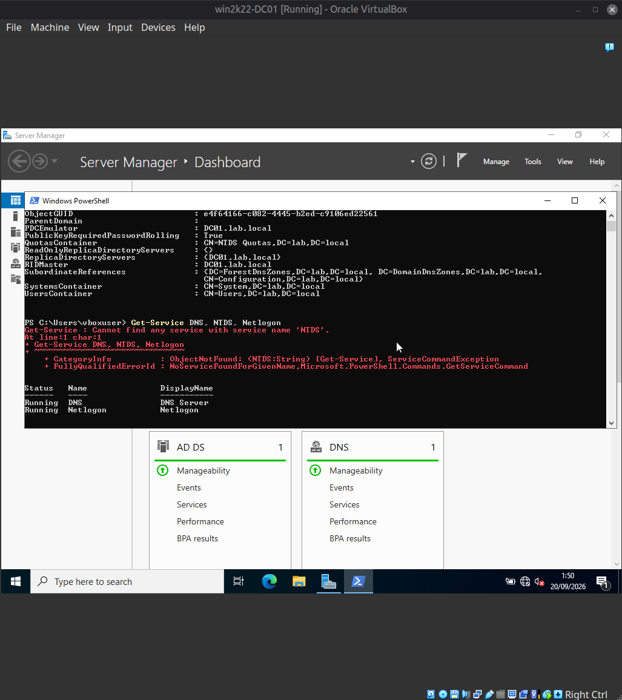
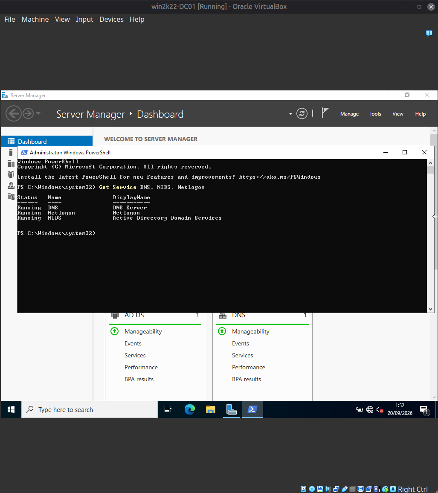
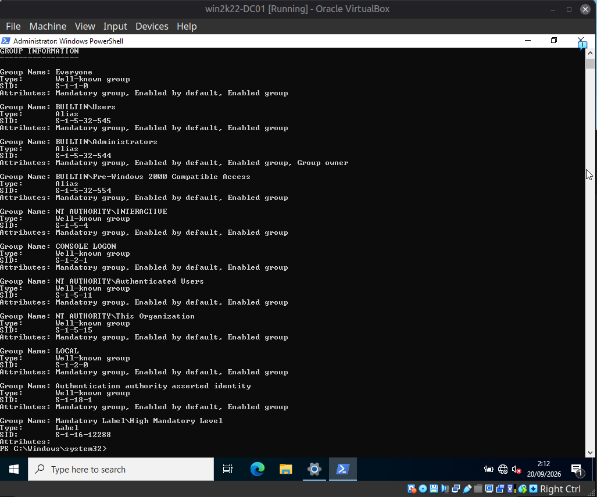
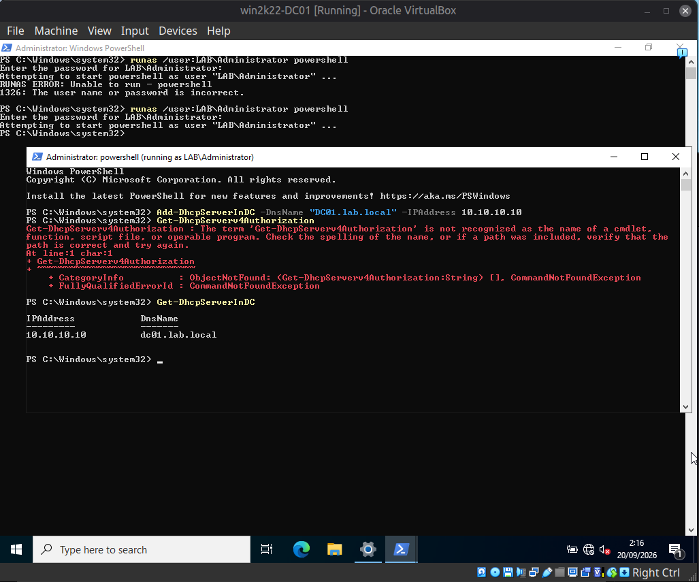

[Home](../README.md) · [Windows domain](README.md) · [Build log](build-log.md) · **Build issues**

# Build issues and lessons learned

This section documents real issues hit during the build — including the root cause and
the diagnostic reasoning — not just the fix.

## Entry #1 — `Get-Service` could not find the NTDS service after DC promotion

**Symptom:**
Immediately after promoting the server to a Domain Controller, running:
```powershell
Get-Service DNS, NTDS, Netlogon
```
returned `DNS` and `Netlogon` as `Running`, but threw an error for `NTDS`:
```
Get-Service : Cannot find any service with service name 'NTDS'.
```

**Root cause:**
The PowerShell session was running in a **non-elevated** context (`PS C:\Users\vboxuser>`
prompt, not `Administrator: Windows PowerShell`). On a Domain Controller, the `NTDS`
service (Active Directory Domain Services) is filtered out of `Get-Service` results when
the calling session is not elevated — even for an account that is a member of the local
Administrators group. `DNS` and `Netlogon` are not subject to the same filtering, which is
why they appeared while `NTDS` did not.

**Resolution:**
Re-launched PowerShell via **Run as administrator**, then re-ran the same command. All
three services returned `Running`.

**Why this matters:**
A missing service in `Get-Service` output does not necessarily mean the service is down
or misconfigured — it can mean the querying session lacks sufficient privilege *to see it*.
Diagnosing privilege scope before assuming a service failure prevents false-positive
incident escalation.

**Screenshots**



*Non-elevated session: `Get-Service` returns DNS and Netlogon but reports it cannot find a service named `NTDS`.*



*Elevated session: all three services, including `NTDS` (Active Directory Domain Services), report `Running`.*

---

## Entry #2 — Local `Administrators` group membership is not the same as `Domain Admins`

**Symptom:**
When attempting to authorize the DHCP server in Active Directory via the "Complete DHCP
configuration" wizard, the pre-filled credentials showed `LAB\vboxuser` with an
"Administrator" badge in Windows Settings → Your info.

**Root cause:**
On a Domain Controller there is no separate local SAM — but a user can still be added
directly to the local `BUILTIN\Administrators` group without being a member of
`Domain Admins` or `Enterprise Admins`. The Settings UI badge reflects local
`BUILTIN\Administrators` membership, which is sufficient to manage the server itself but
**not** sufficient to write to the AD Configuration partition — which is exactly what
DHCP Authorization in AD requires.

**Diagnostic step:**
```powershell
whoami /groups /fo list
```
confirmed `vboxuser` was a member of `BUILTIN\Administrators` only — no `Domain Admins`
or `Enterprise Admins` entry present.

**Resolution:**
Skipped authorization in the wizard, then opened a new session running explicitly as
`LAB\Administrator` (`runas /user:LAB\Administrator powershell`) and ran the
authorization from that session instead.

**Screenshots**



*`whoami /groups /fo list`: the account is in `BUILTIN\Administrators`, but no `Domain Admins` or `Enterprise Admins` entry appears.*

## Entry #3 — Verifying a suggested cmdlet name against official documentation

**Symptom:**
`Get-DhcpServerv4Authorization` returned `CommandNotFoundException` — the cmdlet does not
exist in the `DhcpServer` module.

**Root cause:**
Incorrect cmdlet name assumed during troubleshooting. The correct cmdlet for checking
which DHCP servers are authorized in AD is `Get-DhcpServerInDC` (no "v4Authorization"
suffix).

**Resolution:**
Cross-checked against Microsoft Learn documentation, ran `Get-DhcpServerInDC`, and
confirmed the server listed with its correct `IPAddress` and `DnsName`.

**Screenshots**



*`Get-DhcpServerv4Authorization` is not a recognized cmdlet; `Get-DhcpServerInDC` returns the authorized server (`10.10.10.10`, `dc01.lab.local`).*

---

[← Windows domain](README.md)
