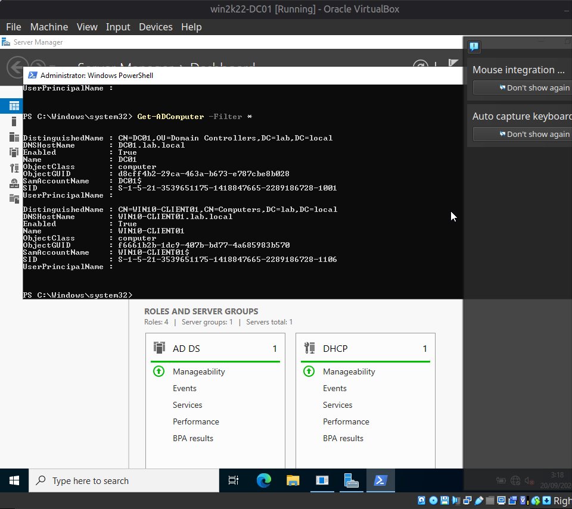

[Home](../README.md) · [Windows domain](README.md) · **Build log** · [Build issues](build-issues.md)

# Domain build log

## Active Directory structure

```
lab.local
└── Helpdesk-Lab
    ├── Computers              OU created; the joined computers sit in the default Computers container
    ├── Groups
    │   ├── GG-Sales           members: dcohen, ylevi
    │   └── GG-IT-Support      members: otech
    └── Users
        ├── Sales              users: dcohen, ylevi · GPO "Sales-Restrictions" linked here
        └── IT-Support         users: otech
```

- **GPOs:** the Default Domain Policy (account lockout threshold set to 3) and `Sales-Restrictions`, linked to the `Sales` OU only.
- **File share:** `\\DC01\Sales-Docs`. The share permission is broad, and the restriction is applied at the NTFS level: `SYSTEM`, `Administrators`, and `GG-Sales`.
- **Delegation:** on the `Sales` OU, `GG-IT-Support` can reset passwords and unlock accounts, and nothing else.

## Build log

### Phase 1 — Domain Controller Setup
- [x] VirtualBox NAT Network created for initial OS install + Windows Update
- [x] Windows Server 2022 (Desktop Experience) installed on `win2k22-DC01`
- [x] Static IP configured (10.10.10.10 / 255.255.255.0), DNS pointed to itself (127.0.0.1)
- [x] Computer renamed to `DC01`
- [x] AD DS role installed
- [x] Server promoted to Domain Controller, new forest `lab.local` created
- [x] Post-promotion health check performed (`Get-ADDomain`, `Get-Service`)
- [x] Adapter switched from NAT Network to isolated Internal Network (`LAB-INT`)
- [x] DHCP role installed and authorized in AD (`Get-DhcpServerInDC` confirmed)
- [x] DHCP scope configured (`LAB-Clients`, 10.10.10.100–200, DNS + Domain Name options set)
- [x] Windows 10 client built and joined to domain
- [x] OU structure created (`Helpdesk-Lab` → `Users`, `Computers`)
- [x] First test user created (`dcohen` / Dana Cohen)
- [x] Fault Scenario 1 documented and resolved (DHCP scope deactivation)
- [x] Fault Scenario 2 documented and resolved (AD logon-hours restriction)
- [x] Fault Scenario 3 documented and resolved (AD account lockout)
- [x] Fault Scenario 4 documented and resolved (broken client DNS)
- [x] AD deep-dive, stages A–B: department OUs, users, security groups, and a restricted file share (snapshots taken first)
- [x] Fault Scenario 5 documented and resolved (share access denied / missing group membership)
- [x] AD deep-dive, stage C: Group Policy linked to a department OU
- [x] Fault Scenario 6 documented and resolved (GPO not applying / user in wrong OU)
- [x] AD deep-dive, stage D: delegation (limited password-reset / unlock rights), using a domain-joined technician workstation with RSAT
- [x] Fault Scenario 7 documented and resolved (technician denied password reset / least-privilege delegation)

### Build verification



*`Get-ADComputer -Filter *` on the DC lists `DC01` and the joined client `WIN10-CLIENT01` in the Computers container.*

---

[← Windows domain](README.md)
