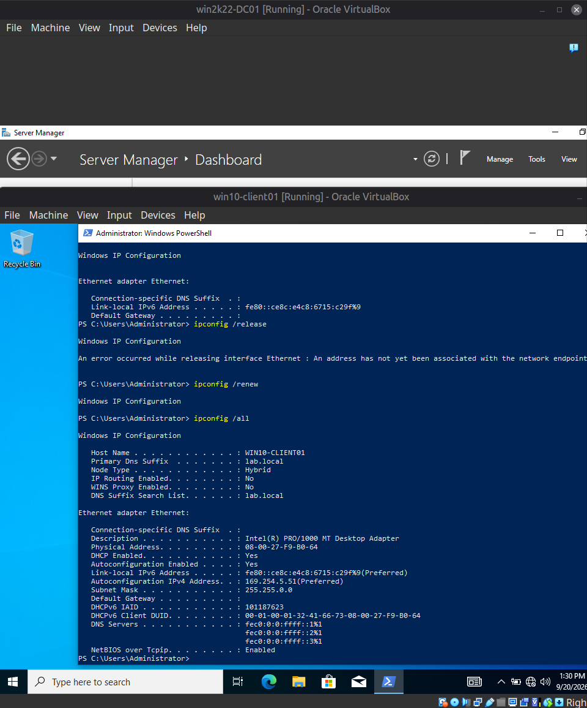
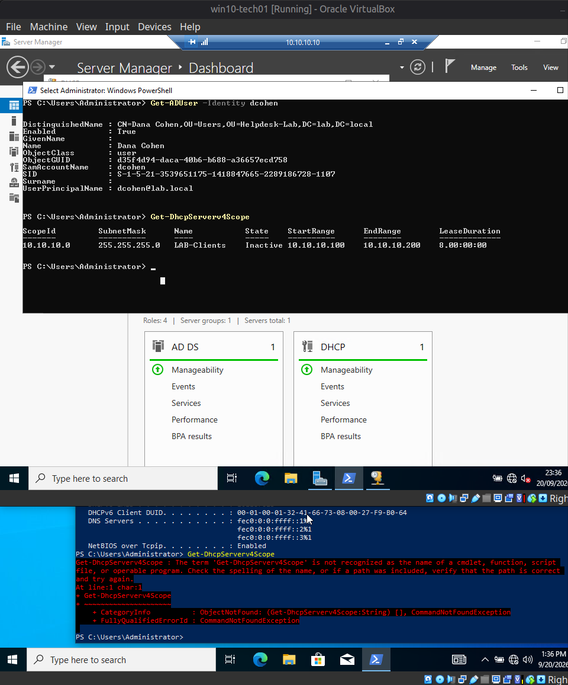

[Home](../../README.md) · [Windows domain](../README.md)

# Scenario 1: DHCP scope deactivated

| | |
|---|---|
| **Reported** | "I can't connect to anything on the network. My internet stopped working a few minutes ago." |
| **Root cause** | The DHCP scope was inactive, so the client got no lease and fell back to an APIPA address (`169.254.x.x`). |
| **Fix** | Re-enabled the scope. The client received a normal lease and RDP from the technician workstation worked again. |
| **Evidence** | `ipconfig /all` on the client, an adapter check, and the scope state on the DC. |

**Ticket:**
> Reporter: Dana Cohen (dcohen)
> Symptom: "I can't connect to anything on the network. My internet stopped working a
> few minutes ago."

**Fault injected:** DHCP scope `LAB-Clients` (10.10.10.0/24) deactivated on the DC via
the DHCP console (`Disable-DhcpServerv4Scope` equivalent), simulating an accidental
scope disable or a service-level issue.

**Diagnostic path:**
1. Attempted to reconnect via RDP from `win10-tech01` — connection failed. This itself
   was diagnostic information: a fully network-dependent remote tool failing is
   consistent with a network-layer problem, not an application-layer one.
2. Accessed `win10-client01` via the local VirtualBox console (simulating an on-site
   visit / phone-guided self-check, since remote access was unavailable) and ran
   `ipconfig /all`. Found an Automatic Private IP Addressing (APIPA) address
   (`169.254.x.x`, subnet `255.255.0.0`, no default gateway) — the signature of a client
   that received no DHCP response at all, as opposed to a misconfigured static IP.
3. Ran `Get-NetAdapter` to rule out a physical/driver-level issue before suspecting
   DHCP — adapter status was `Up`, narrowing the cause to the DHCP service or scope.
4. Escalated to the DC (reachable directly via its static IP, independent of DHCP) and
   checked `Get-DhcpServerv4Scope` — found `State: Inactive`.

**Root cause:** DHCP scope for the client subnet was disabled at the server, so no
client on that subnet could obtain or renew an IP lease; the existing lease had already
expired and fallen back to APIPA.

**Resolution:** Re-enabled the scope (`Enable-DhcpServerv4Scope`), then verified from
the client with `ipconfig /release` / `/renew` that a proper lease
(10.10.10.x / 255.255.255.0 / DNS 10.10.10.10) was issued. Confirmed full recovery by
successfully re-establishing an RDP session from `win10-tech01`, closing the loop from
the technician's point of view rather than just the client's.

**Screenshots**

*On the client, `ipconfig /all` shows an APIPA address (`169.254.5.51`), subnet mask `255.255.0.0`, and no default gateway, while DHCP is still enabled.*

*On the DC, `Get-DhcpServerv4Scope` shows the `LAB-Clients` scope with `State: Inactive`.*

---

[← Windows domain](../README.md) · [Next: Scenario 2: Logon-hours restriction →](02-logon-hours-restriction.md)
