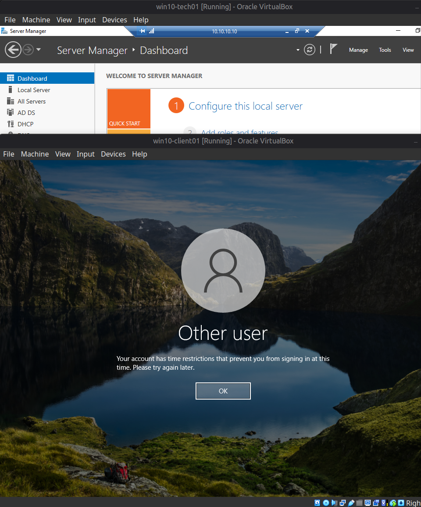
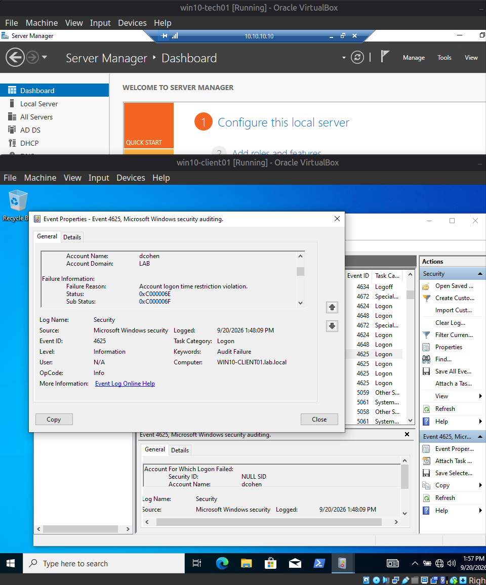

[Home](../../README.md) · [Windows domain](../README.md)

# Scenario 2: AD account logon-hours restriction

| | |
|---|---|
| **Reported** | "I'm trying to log into my computer this morning and it's telling me something about time restrictions." |
| **Root cause** | The account's Logon Hours denied every hour of the week. |
| **Fix** | Set Logon Hours back to permit all hours in Active Directory Users and Computers. Sign-in worked again. |
| **Evidence** | Security event 4625: "Account logon time restriction violation", Status `0xC000006E`, Sub Status `0xC000006F`. |

**Ticket:**
> Reporter: Dana Cohen (dcohen)
> Symptom: "I'm trying to log into my computer this morning and it's telling me
> something about time restrictions — I've never seen this before. I need to get into
> my email."

**Fault injected:** In Active Directory Users and Computers, the account's **Logon
Hours** were set to deny all hours, every day of the week (Account tab → Logon Hours →
select entire grid → Logon Denied), simulating either a misconfigured account policy or
a scheduling error made when the account was originally provisioned.

**Diagnostic path:**
1. Reproduced the symptom directly: attempting interactive logon as `dcohen` on
   `win10-client01` returned Windows' own message, *"Your account has time restrictions
   that prevent you from signing in at this time."* — a clear signal, but not treated as
   sufficient on its own for a ticket record; verified independently rather than
   taking the on-screen message (or a phone-reported description of it) at face value.
2. Logged on locally as `LAB\Administrator` (unaffected by the restriction) to access
   Event Viewer, since `dcohen` could not log on to generate or view it interactively.
3. Filtered the **Security** log (Windows Logs → Security → Filter Current Log →
   Event ID `4625`) to isolate failed logon attempts rather than scrolling past
   unrelated 4624 (successful logon) and system events.
4. Opened the matching 4625 event for `dcohen` and read the **Failure Information**
   block: `Failure Reason: Account logon time restriction violation`, `Status:
   0xC000006E`, `Sub Status: 0xC000006F`.

**Root cause:** The account's Logon Hours attribute denied logon at all times, so
Active Directory rejected the authentication request regardless of password
correctness — confirmed independently via the on-screen message, the plain-text
Failure Reason, and the status/sub-status code pair in the Security event, rather than
relying on any single source.

**Note on the status codes:** initial troubleshooting assumed `0xC000006F` would appear
as the primary `Status` value with `Sub Status: 0x0`. The actual event showed
`Status: 0xC000006E` (a general "account restriction" status covering several distinct
causes — time, workstation, and others) with `0xC000006F` appearing as the `Sub Status`
that identifies the restriction as specifically time-based. This was caught by reading
the actual event output rather than assuming the codes from general knowledge, and
corrected before being recorded here.

**Resolution:** Reset Logon Hours to permit all hours (same grid, all cells selected,
**Logon Permitted**) via AD Users and Computers → dcohen → Properties → Account tab.

**Verification:** Retried interactive logon as `dcohen` on `win10-client01` — succeeded.

**Screenshots**

*The client's sign-in screen: "Your account has time restrictions that prevent you from signing in at this time."*

*Security event 4625 for `dcohen`: failure reason "Account logon time restriction violation", Status `0xC000006E`, Sub Status `0xC000006F`.*

---

[← Previous: Scenario 1: DHCP scope deactivated](01-dhcp-scope-deactivated.md) · [Next: Scenario 3: Account lockout →](03-account-lockout.md)
