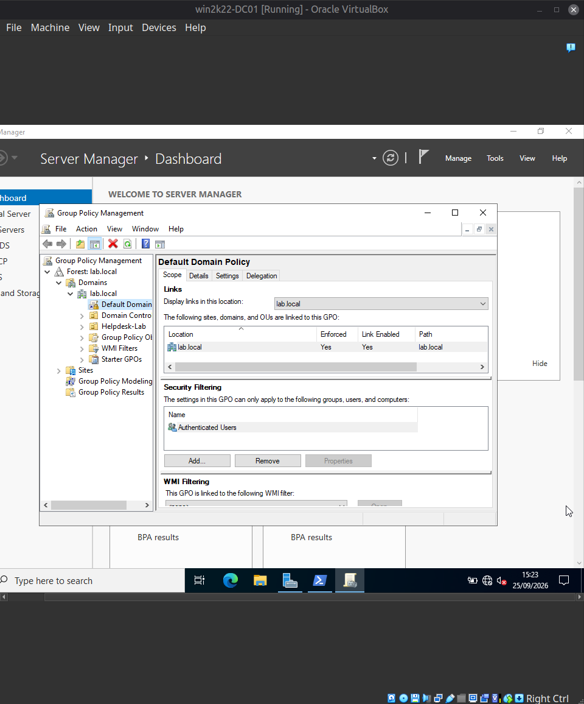
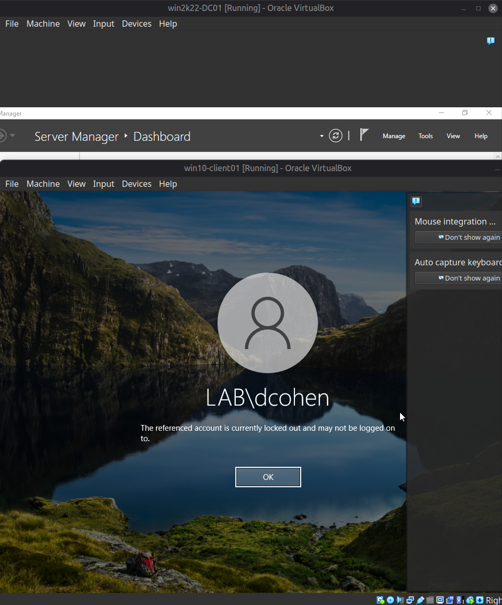
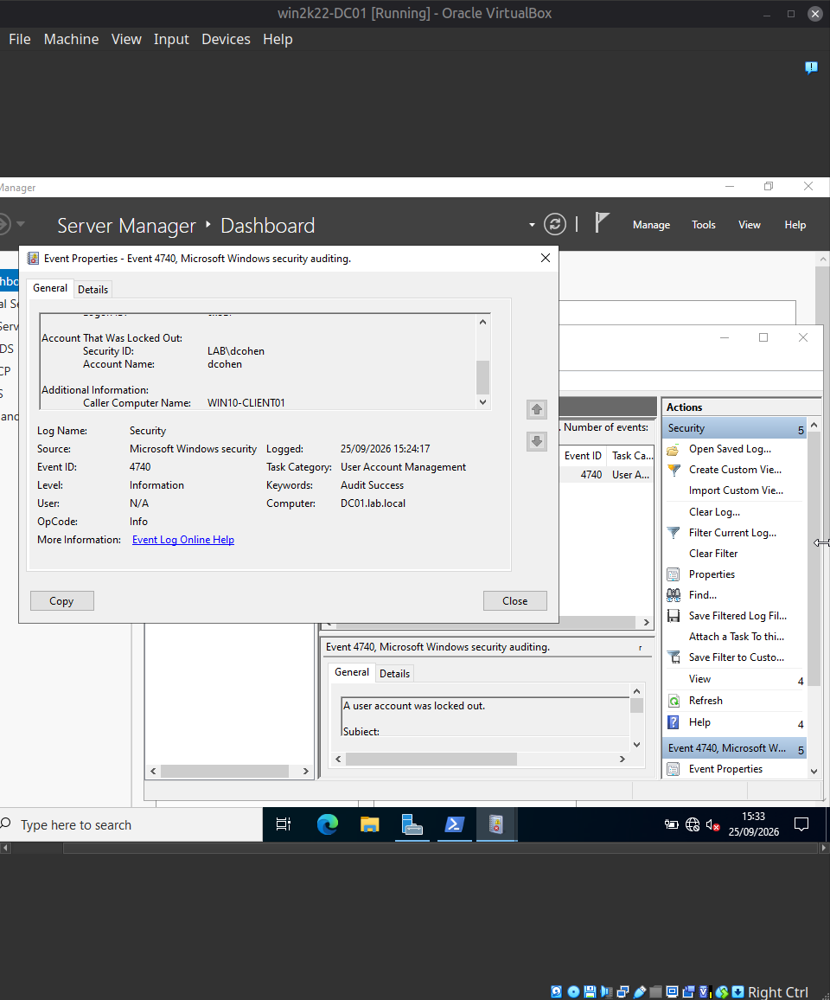

[Home](../../README.md) · [Windows domain](../README.md)

# Scenario 3: AD account lockout (repeated failed logon attempts)

| | |
|---|---|
| **Reported** | "I tried logging in a few times this morning, I think I mistyped my password, and now it says my account is locked." |
| **Root cause** | Three failed sign-ins reached the lockout threshold, which was set to 3. |
| **Fix** | Unlocked the account in Active Directory Users and Computers. Sign-in worked again. |
| **Evidence** | Event 4740 on the domain controller, including the caller computer name. |

**Ticket:**
> Reporter: Dana Cohen (dcohen)
> Symptom: "I tried logging in a few times this morning, I think I mistyped my
> password, and now it says my account is locked."

**Setup:** Configured an Account Lockout Policy on the domain (Default Domain Policy →
Computer Configuration → Policies → Windows Settings → Security Settings → Account
Policies → Account Lockout Policy), setting `Account lockout threshold` to 3 invalid
attempts, with Windows' suggested defaults accepted for lockout duration and counter
reset (30 minutes each). Verified the policy applied domain-wide with
`Get-ADDefaultDomainPasswordPolicy` and forced immediate client pickup with
`gpupdate /force` rather than waiting for the normal GPO refresh cycle.

**Fault reproduced (not artificially injected):** unlike Scenarios #1 and #2, this fault
was produced by genuinely triggering the mechanism — three consecutive incorrect
password attempts as `dcohen` on `win10-client01`, which Windows itself locked
automatically per the policy above. Windows displayed: *"The referenced account is
currently locked out and may not be logged on to."*

**Diagnostic path:**
1. Looked for the corresponding event first on `win10-client01` (Security log, filtered
   to Event ID 4740) and found nothing there. This was corrected by checking where the
   event actually gets logged: **4740 (Account Locked Out) is recorded on the Domain
   Controller**, not the client, because the DC is the component that counts failed
   attempts and enforces the lockout — the client only displays the resulting message.
2. Located the event on `win2k22-DC01` instead, filtered the same way. The event
   confirmed `Account Name: dcohen` and, notably, `Caller Computer Name: WIN10-CLIENT01`
   — the field that would distinguish a legitimate user's mistyped password from
   attempts originating from an unexpected machine (a meaningfully different situation
   from a security standpoint, even though both produce the same lockout).

**Root cause:** Three consecutive failed authentication attempts against `dcohen`
reached the configured lockout threshold, and Active Directory locked the account
domain-wide regardless of which device it's accessed from.

**Resolution:** Unlocked the account via AD Users and Computers → dcohen → Properties →
Account tab → **Unlock account** checkbox (only present while a lockout is active) →
Apply.

**Verification:** Logged on again as `dcohen` with the correct password on
`win10-client01` — succeeded.

**Screenshots**

*Default Domain Policy in Group Policy Management, linked to `lab.local` (Enforced: Yes, Link Enabled: Yes). The account lockout threshold was set in this GPO.*

*The client's sign-in screen after repeated wrong passwords: "The referenced account is currently locked out and may not be logged on to."*

*Event 4740 on the Domain Controller (`DC01.lab.local`): account `dcohen` locked out, caller computer `WIN10-CLIENT01`.*

---

[← Previous: Scenario 2: Logon-hours restriction](02-logon-hours-restriction.md) · [Next: Scenario 4: Broken DNS →](04-broken-dns.md)
