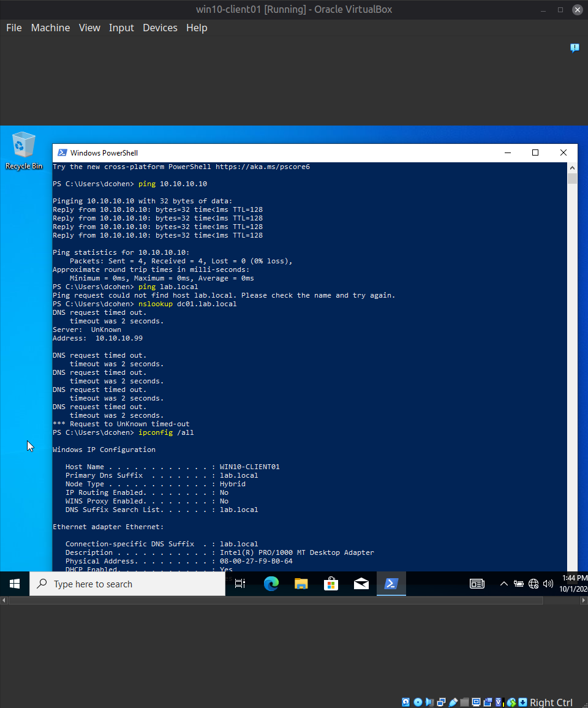
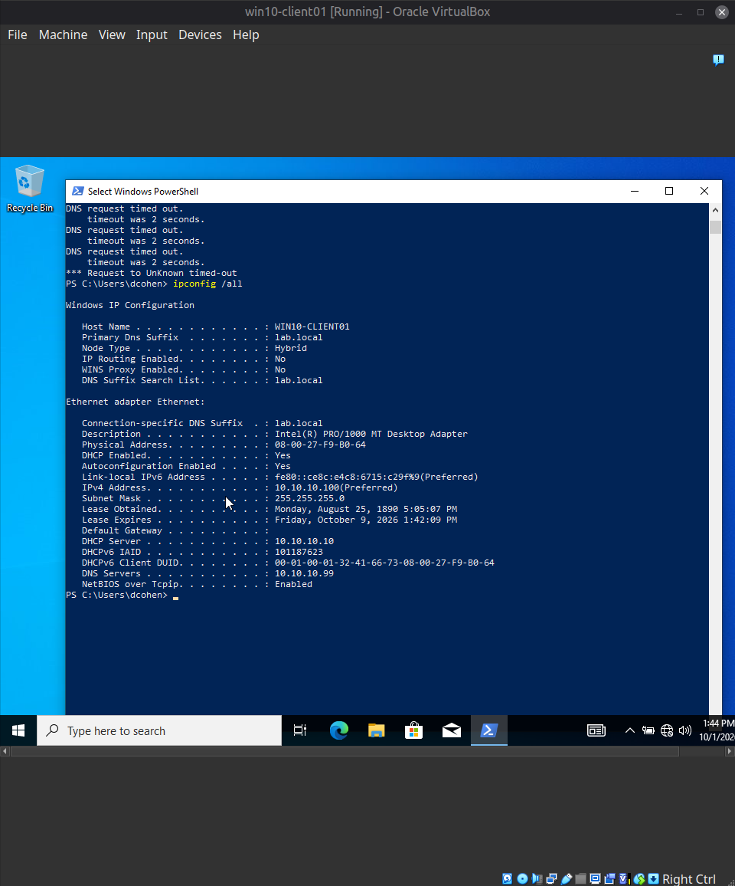
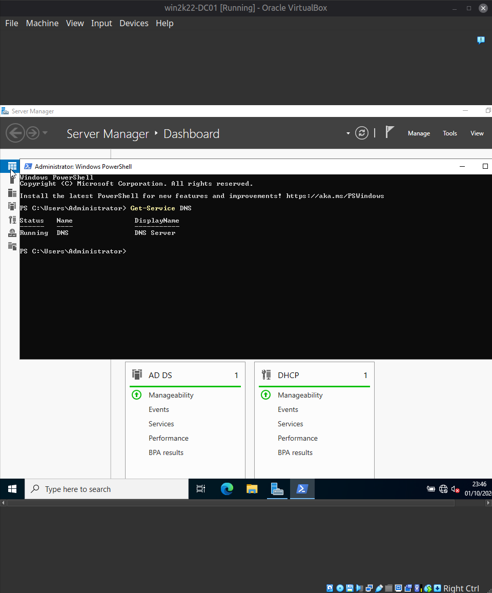
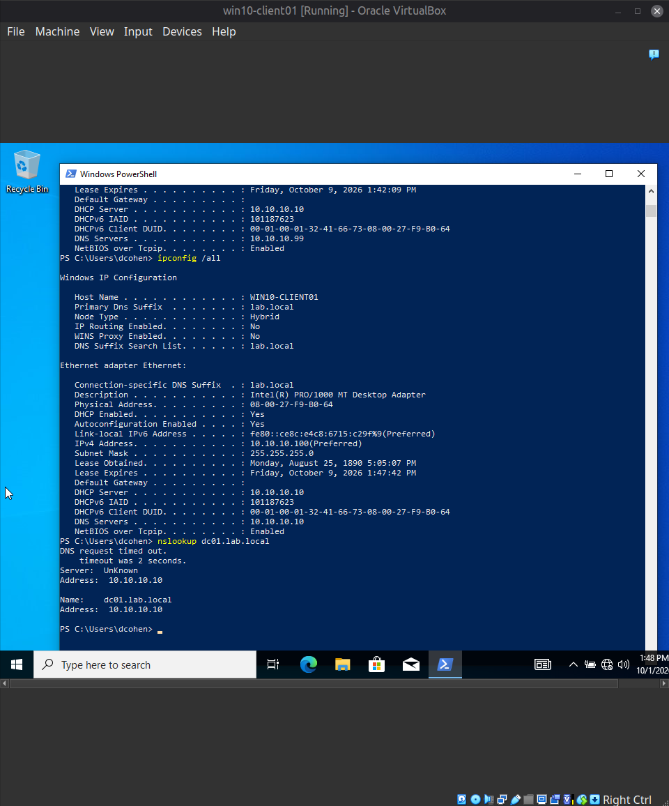

[Home](../../README.md) · [Windows domain](../README.md)

# Scenario 4: Broken DNS (network up, name resolution down)

| | |
|---|---|
| **Reported** | "Nothing is loading — I can't open anything on the shared drive, and my browser homepage won't load either." |
| **Root cause** | The client's DNS server was manually set to `10.10.10.99`, which does not exist. Connectivity by IP address was fine. |
| **Fix** | Switched the adapter back to automatic DNS. Names resolved again. |
| **Evidence** | `ping` by IP works while `ping` and `nslookup` by name fail; `ipconfig /all` shows the wrong DNS server; the DNS service on the DC is running. |

**Ticket:**
> Reporter: Dana Cohen (dcohen)
> Symptom: "Nothing is loading — I can't open anything on the shared drive, and my
> browser homepage won't load either."

**Fault injected:** On `win10-client01`, the network adapter's IPv4 properties were
changed to use a manually specified DNS server, `10.10.10.99` (an address with no host
behind it), while the IP address itself stayed on DHCP. This overrides the DNS server
that the DHCP scope normally hands out (Option 6, `10.10.10.10`), simulating a leftover
manual change made while someone was troubleshooting an unrelated problem.

**Diagnostic path:**
1. Separated "is the network up?" from "do names resolve?": `ping 10.10.10.10` (the DC,
   by IP) succeeded with 0% loss, so IP-level connectivity was fine. This is the key
   contrast with Scenario 1, where nothing was reachable at all.
2. `ping lab.local` failed ("could not find host") and `nslookup dc01.lab.local` timed
   out, reporting `Server: UnKnown` at `10.10.10.99` — name lookups were being sent to
   the wrong server.
3. `ipconfig /all` showed a valid DHCP lease (`10.10.10.100`, mask `255.255.255.0`,
   DHCP server `10.10.10.10`) but `DNS Servers: 10.10.10.99`, which does not match what
   the scope hands out (`10.10.10.10`). The root cause was visible directly in the
   adapter configuration without needing Event Viewer.
4. Ruled out a server-side cause before changing anything on the client: on
   `win2k22-DC01`, `Get-Service DNS` returned `Running`. The negative finding is
   recorded deliberately — it is what justifies looking at the client rather than the DC.

**Root cause:** The client's DNS server setting was manually overridden to a
non-existent server, so every name lookup timed out while connectivity by IP address was
unaffected.

**Resolution:** Set the adapter back to **Obtain DNS server address automatically**, so
the client takes the DHCP-provided DNS server (`10.10.10.10`). No other setting changed.

**Verification:** `ipconfig /all` showed `DNS Servers: 10.10.10.10`, and
`nslookup dc01.lab.local` returned `Name: dc01.lab.local`, `Address: 10.10.10.10`.

**Observation on the verification output:** even after the fix, `nslookup` began with a
"DNS request timed out" line and `Server: UnKnown`. That comes from `nslookup` trying to
reverse-resolve the DNS server's own address, which fails when no reverse lookup (PTR)
zone exists — consistent with this lab having none (not explicitly verified in DNS
Manager). The forward lookup, the part that matters here, succeeded. Telling this
cosmetic noise apart from the genuine failure earlier (where the forward lookups
themselves timed out) is part of reading `nslookup` output correctly.

**How this differs from Scenario 1 (same user-reported symptom, different cause):**

| Check | Scenario 1 — DHCP scope inactive | Scenario 4 — wrong DNS server |
|---|---|---|
| `ping` the DC by IP | Fails | Succeeds |
| `ipconfig /all` | APIPA address (`169.254.x.x`) | Valid lease, wrong DNS server |
| Where the cause was found | DHCP scope state on the DC | Adapter configuration on the client |

**Screenshots**

*Pinging the DC by IP succeeds, while `ping lab.local` fails and `nslookup dc01.lab.local` times out against the configured DNS server `10.10.10.99`.*

*`ipconfig /all` shows a valid DHCP lease (`10.10.10.100`, DHCP server `10.10.10.10`) but `DNS Servers: 10.10.10.99`.*

*On the DC, `Get-Service DNS` returns `Running`, ruling out a server-side cause.*

*After switching back to automatic DNS: `DNS Servers` is `10.10.10.10` again and `nslookup dc01.lab.local` resolves to `10.10.10.10`. The first "timed out" line is the reverse lookup of the DNS server's own address, explained above.*

---

[← Previous: Scenario 3: Account lockout](03-account-lockout.md) · [Next: Scenario 5: Share access denied →](05-share-access-denied.md)
