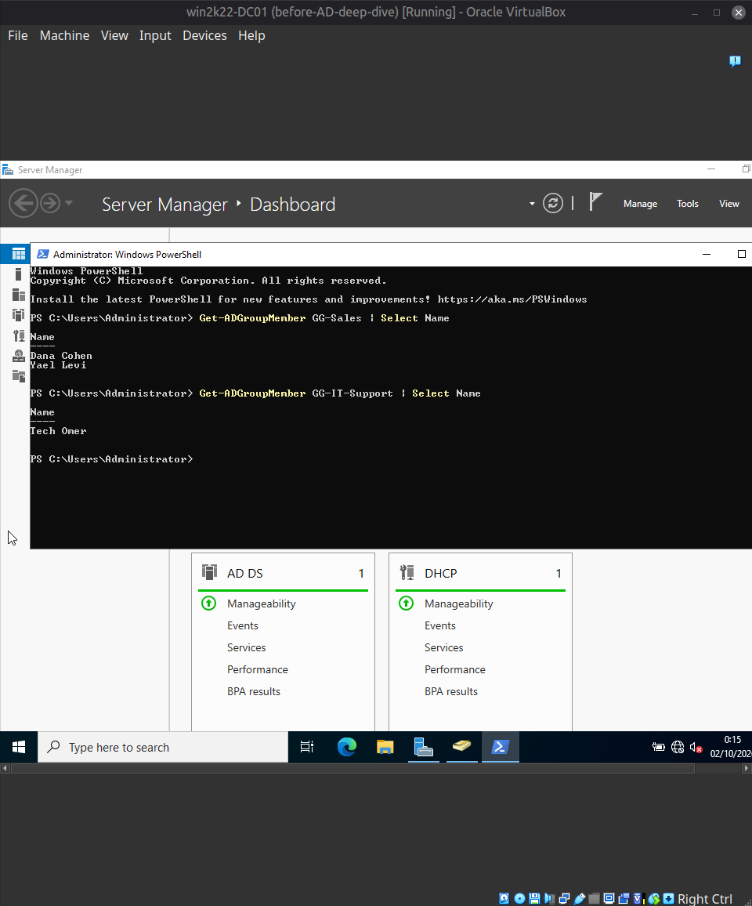
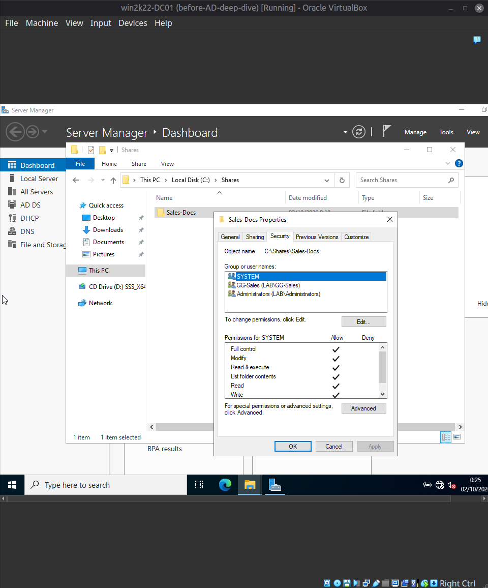
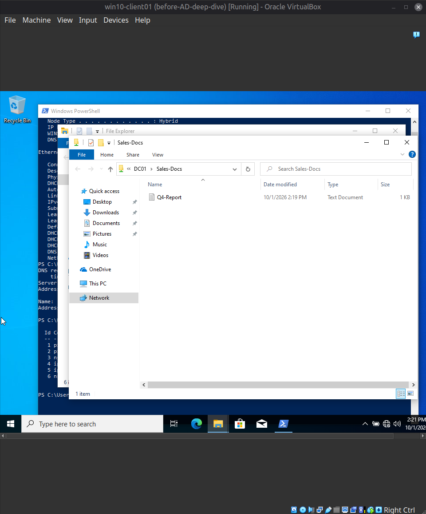
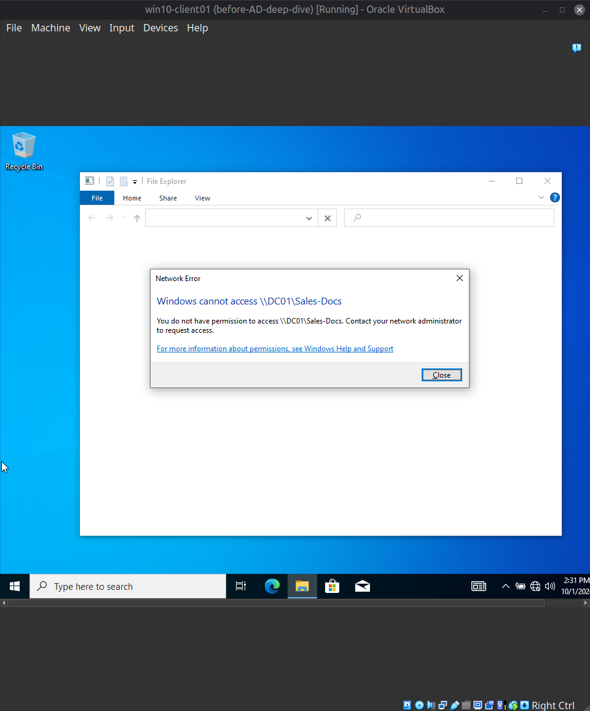
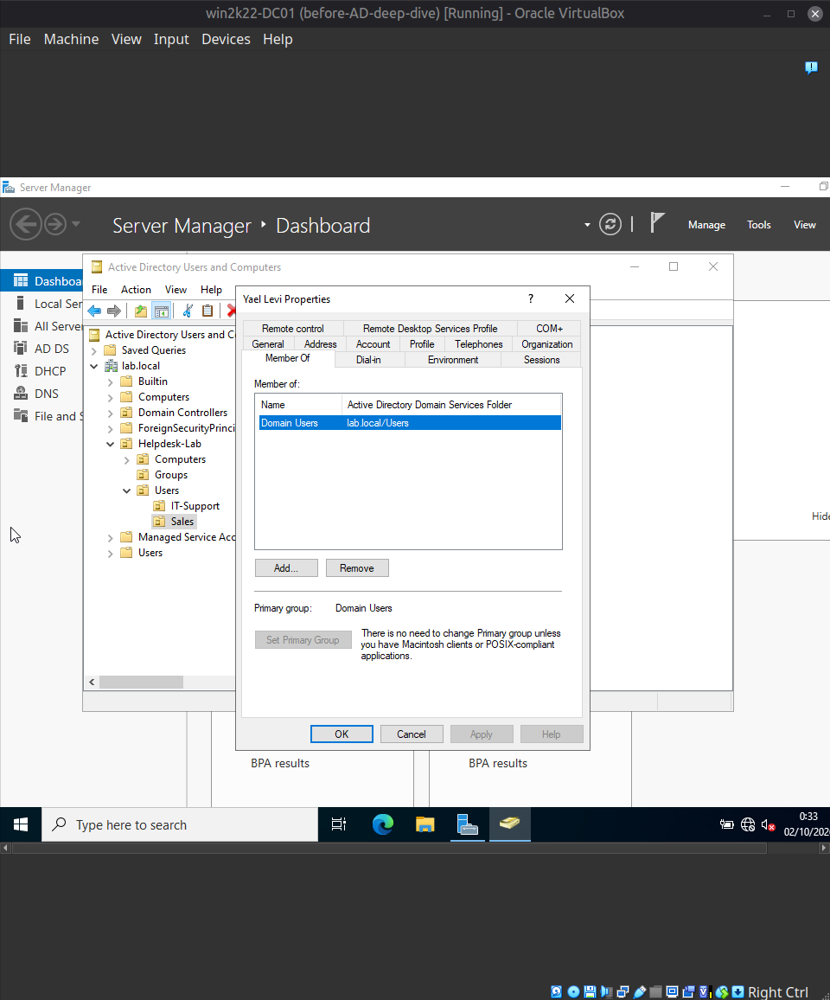

[Home](../../README.md) · [Windows domain](../README.md)

# Scenario 5: Share access denied because of missing group membership

| | |
|---|---|
| **Reported** | "I just started in Sales and I can't open the Sales-Docs folder. It says I don't have permission." |
| **Root cause** | The user was not a member of `GG-Sales`, the only group the folder's NTFS permissions allow. |
| **Fix** | Added her to `GG-Sales`. The share opened after she signed out and back in. |
| **Evidence** | Her Member Of tab in Active Directory, and the same share opening for a `GG-Sales` member. |

**Setup (AD deep-dive, stages A–B).** Snapshots (`before-AD-deep-dive`) were taken on the
DC and the client before any changes. Then:
- **OUs:** `Sales` and `IT-Support` under `Helpdesk-Lab\Users`, and a `Groups` OU under
  `Helpdesk-Lab`.
- **Users:** `ylevi` (Yael Levi, Sales) and `otech` (Omer Tech, IT-Support) created;
  `dcohen` moved into `Sales`.
- **Security groups:** `GG-Sales` (members `dcohen`, `ylevi`) and `GG-IT-Support`
  (member `otech`), both Global / Security. Membership confirmed with
  `Get-ADGroupMember`.
- **File share:** `C:\Shares\Sales-Docs`, shared as `Sales-Docs`. The share permission was
  left broad (`Everyone`: Full Control) and the real restriction was applied at the NTFS
  level: inheritance disabled and converted to explicit entries, the `Users` and
  `Authenticated Users` entries removed, `SYSTEM` and `Administrators` kept, and
  `GG-Sales` added with Modify. The effective access is the more restrictive of the two
  layers, so only the NTFS list decides who gets in. The final entry list
  (`SYSTEM`, `GG-Sales`, `Administrators`) was checked on the folder's Security tab.
- **Lab simplification:** the share is hosted on the DC to avoid building another server.
  A production environment would not serve file shares from a Domain Controller.

**Baseline check.** `dcohen` (a `GG-Sales` member) opened `\\DC01\Sales-Docs` and saw the
test file. That only proves a *member* gets in; it does not prove a *non-member* is
blocked, so the negative case was tested next.

**Ticket:**
> Reporter: Yael Levi (ylevi)
> Symptom: "I just started in Sales and I can't open the Sales-Docs folder. It says I
> don't have permission."

**Fault injected:** `ylevi` was removed from `GG-Sales`, simulating a new hire whose
group membership was never set up.

**Diagnostic path:**
1. Reproduced the symptom: logged on as `ylevi` on `win10-client01` and opened
   `\\DC01\Sales-Docs` — Windows returned "You do not have permission to access
   \\DC01\Sales-Docs".
2. Checked the account in Active Directory (Properties → Member Of): only
   `Domain Users`, not `GG-Sales`. A client-side group check with `whoami /groups` was
   attempted but not completed, so the DC-side check was the evidence used.
3. Excluded the folder itself as the cause: the same share had opened normally for a
   `GG-Sales` member earlier, so the difference was the user, not the share.

**Root cause:** access to the folder is granted to `GG-Sales` only, and `ylevi` was not a
member of that group.

**Resolution:** added `ylevi` to `GG-Sales` in Active Directory Users and Computers.

**Verification and an observation worth knowing:**
- Retrying while `ylevi` was still logged in, right after the group change, still
  returned Access Denied.
- After signing out and back in as `ylevi`, the folder opened.
- This is consistent with group membership being read when the user logs on, so a change
  does not reach an already-open session. That is the observed behavior; the mechanism
  itself was not verified directly (for example by comparing the session's group list
  before and after). Practical takeaway: after adding a user to a group, have them sign
  out and back in before concluding the fix did not work.

**Screenshots**

*`Get-ADGroupMember` lists Dana Cohen and Yael Levi in `GG-Sales`, and one member in `GG-IT-Support`.*

*NTFS permissions on `Sales-Docs` after removing inheritance and the broad entries: `SYSTEM`, `GG-Sales`, and `Administrators`.*

*A `GG-Sales` member (`dcohen`) opens `\\DC01\Sales-Docs` and sees the test file.*

*Yael Levi, who is not in `GG-Sales`, gets "You do not have permission to access \\DC01\Sales-Docs".*

*Yael Levi's Member Of tab in Active Directory: only `Domain Users`.*

---

[← Previous: Scenario 4: Broken DNS](04-broken-dns.md) · [Next: Scenario 6: GPO not applying (wrong OU) →](06-gpo-not-applying-wrong-ou.md)
