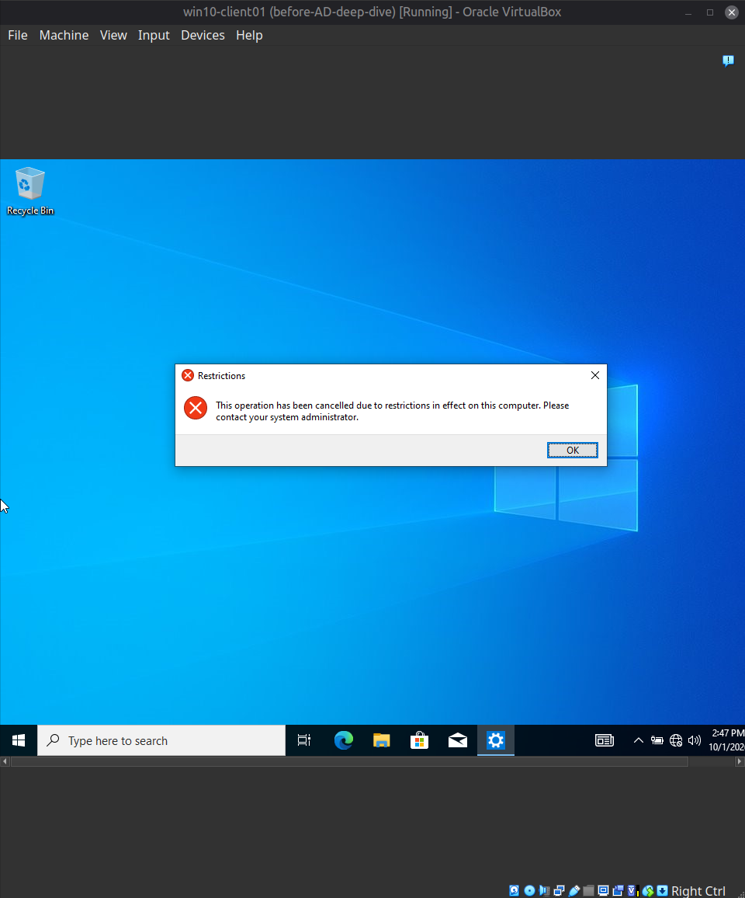
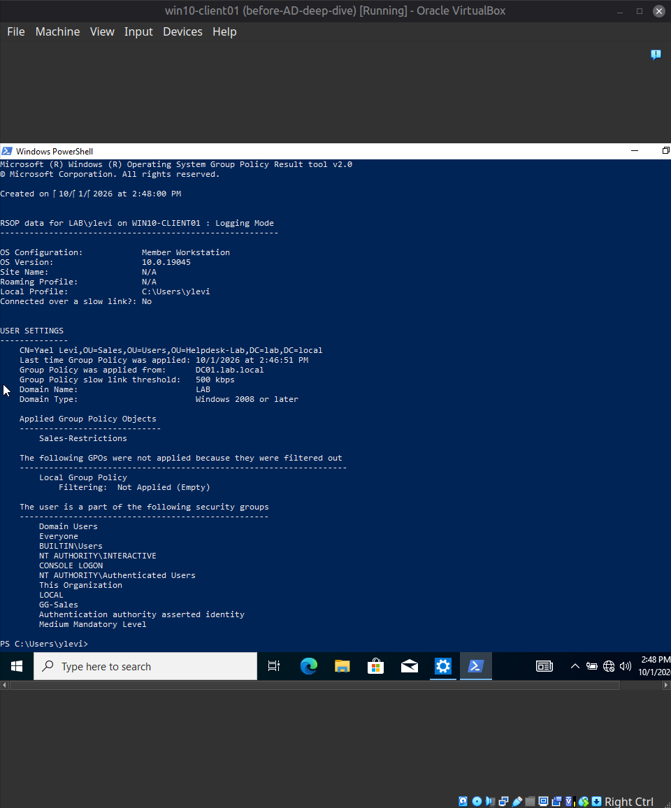
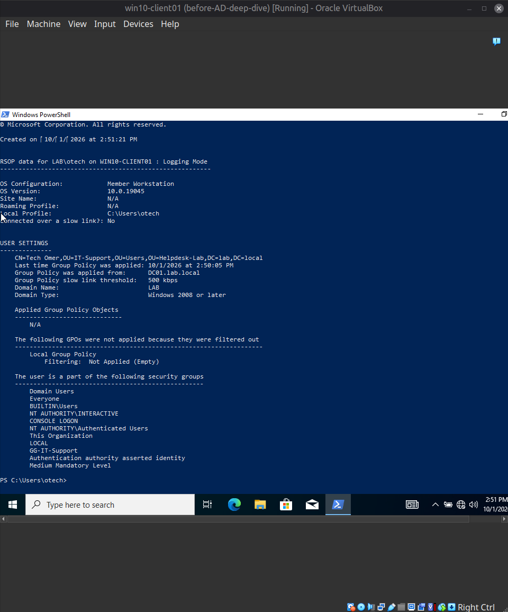
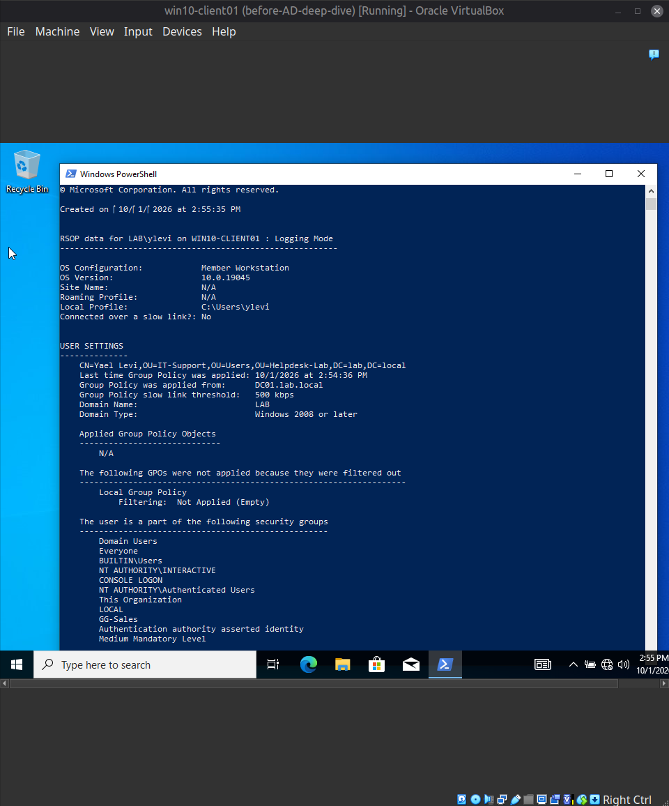
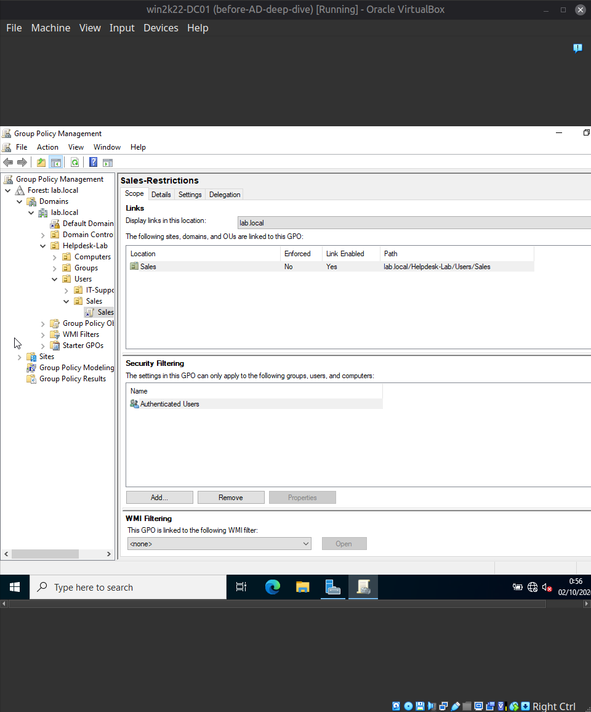
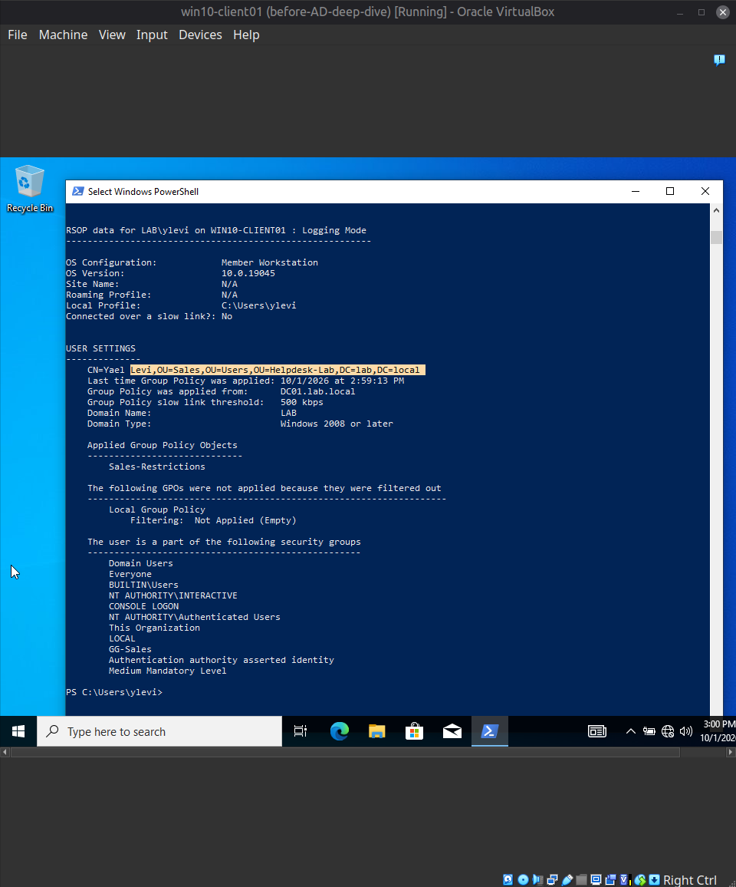

[Home](../../README.md) · [Windows domain](../README.md)

# Scenario 6: Group Policy not applying because the user is in the wrong OU

| | |
|---|---|
| **Reported** | "I can open the Control Panel on my computer, but my colleagues in Sales say theirs is blocked. Is mine broken?" |
| **Root cause** | Her account had been moved to the IT-Support OU, but the policy is linked to the Sales OU. |
| **Fix** | Moved the account back to Sales. `gpupdate /force` was enough for the policy to apply again. |
| **Evidence** | `gpresult` on the client, and the link scope in Group Policy Management. |

**Setup (AD deep-dive, stage C).** A GPO named `Sales-Restrictions` was created and linked
to the `Sales` OU only (`lab.local/Helpdesk-Lab/Users/Sales`; Link Enabled: Yes,
Enforced: No), not to the whole domain, so it applies to Sales users and nobody else.
Security Filtering was left at the default (`Authenticated Users`). The policy setting
is User Configuration → Administrative Templates → Control Panel → *Prohibit access to
Control Panel and PC settings* = Enabled.

**Baseline checks, in both directions:**
- `ylevi` (in `Sales`): after `gpupdate /force`, launching `control` was refused with
  "This operation has been cancelled due to restrictions in effect on this computer", and
  `gpresult /r /scope user` listed `Sales-Restrictions` under Applied Group Policy
  Objects.
- `otech` (in `IT-Support`): Control Panel opened normally, and `gpresult` showed
  `OU=IT-Support` with Applied Group Policy Objects = `N/A`.

Proving the policy does *not* apply to others matters as much as proving it applies to the
intended users, so both directions were tested before introducing a fault.

**Ticket:**
> Reporter: Yael Levi (ylevi)
> Symptom: "I can open the Control Panel on my computer, but my colleagues in Sales say
> theirs is blocked. Is mine broken?"

**Fault injected:** `ylevi` was moved from the `Sales` OU to the `IT-Support` OU,
simulating an account that was misplaced or left behind during a reorganization. After
logging on again, Control Panel opened for her.

**Diagnostic path:**
1. On the client, `gpresult /r /scope user` showed her account in
   `OU=IT-Support` and Applied Group Policy Objects = `N/A` — `Sales-Restrictions` was
   not being applied.
2. On the DC, Group Policy Management showed `Sales-Restrictions` linked only to the
   `Sales` OU, with the link enabled and not enforced, and Security Filtering set to
   `Authenticated Users`.
3. Comparing the two: the GPO is scoped by the OU where the user object sits, and her
   object was no longer in that OU. The other possible causes were ruled out by what was
   visible: the link was enabled, the filtering did not exclude her, and the client had
   pulled policy from `DC01.lab.local`.

**Worth noting:** `gpresult` still listed her as a member of `GG-Sales`. Group membership
did not bring the policy back, because this GPO is scoped by OU, not by group. Targeting
by group would require adding that group to the GPO's Security Filtering.

**Root cause:** the user account was in the wrong OU, so the OU-linked policy did not
reach it.

**Resolution:** moved `ylevi` back to the `Sales` OU in Active Directory Users and
Computers (rather than changing the GPO link, since she works in Sales).

**Verification:** `gpupdate /force` followed by `gpresult /r /scope user` showed
`OU=Sales` and `Sales-Restrictions` under Applied Group Policy Objects, with a later
"last applied" time than before the move, and launching `control` was blocked again.
After the OU change, `gpupdate /force` alone was enough; no sign-out was needed.

**Screenshots**

*A Sales user launching Control Panel: "This operation has been cancelled due to restrictions in effect on this computer."*

*`gpresult /r /scope user` for `ylevi` in `OU=Sales`: `Sales-Restrictions` appears under Applied Group Policy Objects.*

*The same check for `otech` in `OU=IT-Support`: Applied Group Policy Objects is `N/A`.*

*After the fault, `gpresult` for `ylevi` shows `OU=IT-Support` and no applied GPO, while `GG-Sales` is still in her group list.*

*On the DC, `Sales-Restrictions` is linked only to `lab.local/Helpdesk-Lab/Users/Sales` (Link Enabled: Yes, Enforced: No); Security Filtering is `Authenticated Users`.*

*After moving her back: `OU=Sales` and `Sales-Restrictions` under Applied Group Policy Objects.*

---

[← Previous: Scenario 5: Share access denied](05-share-access-denied.md) · [Next: Scenario 7: Delegated password reset →](07-delegated-password-reset.md)
