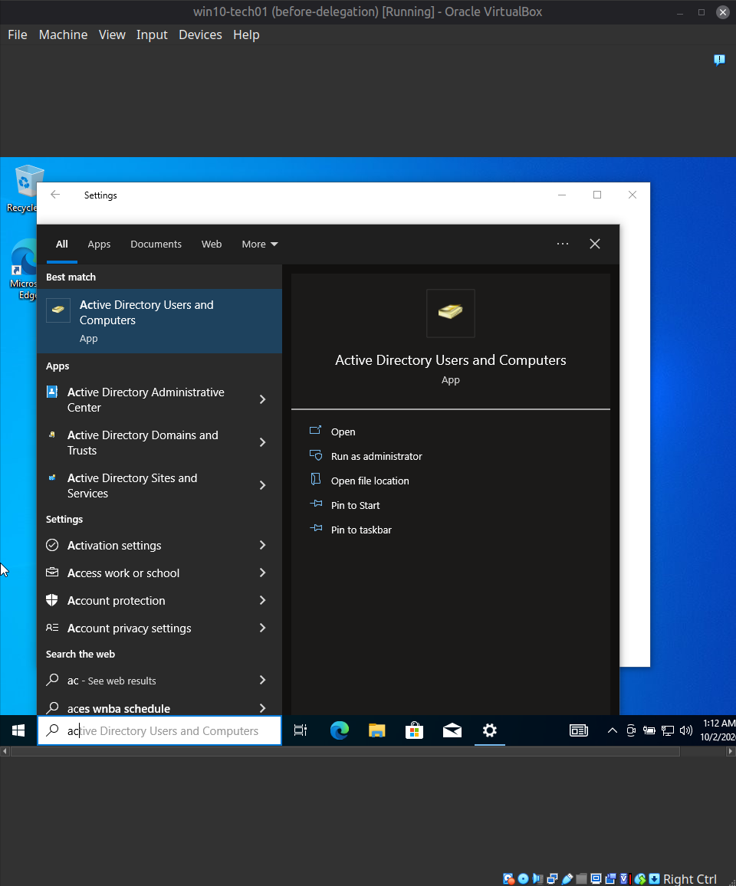
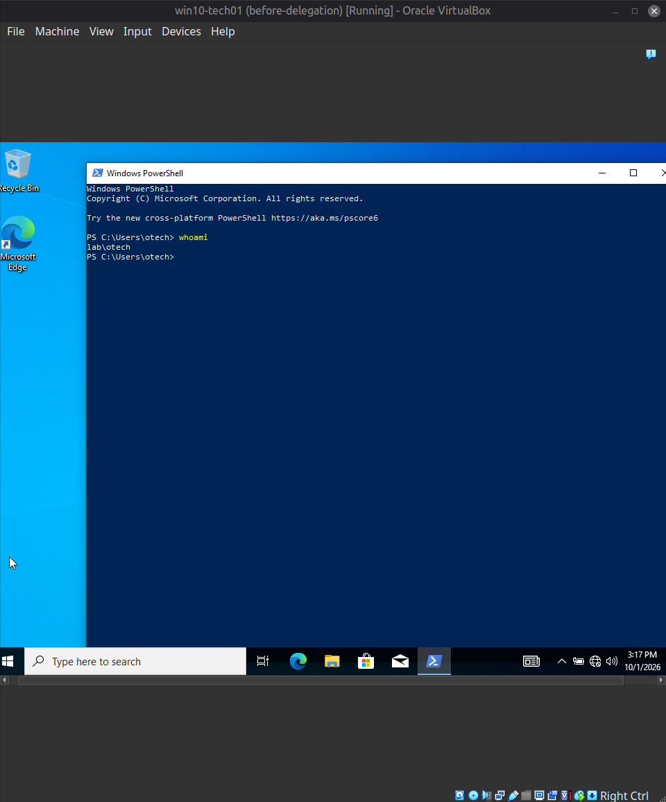
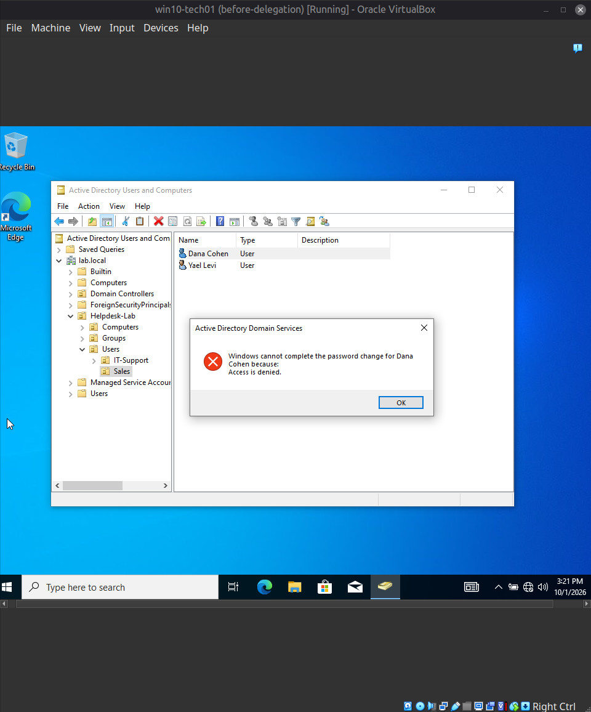
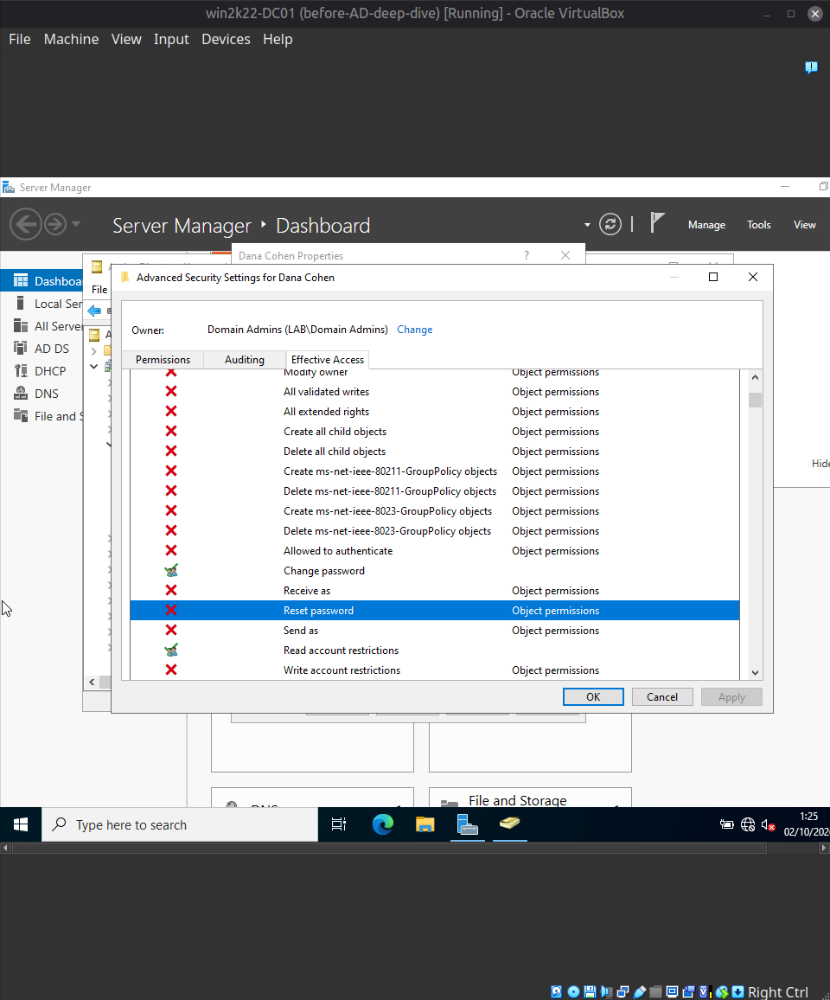
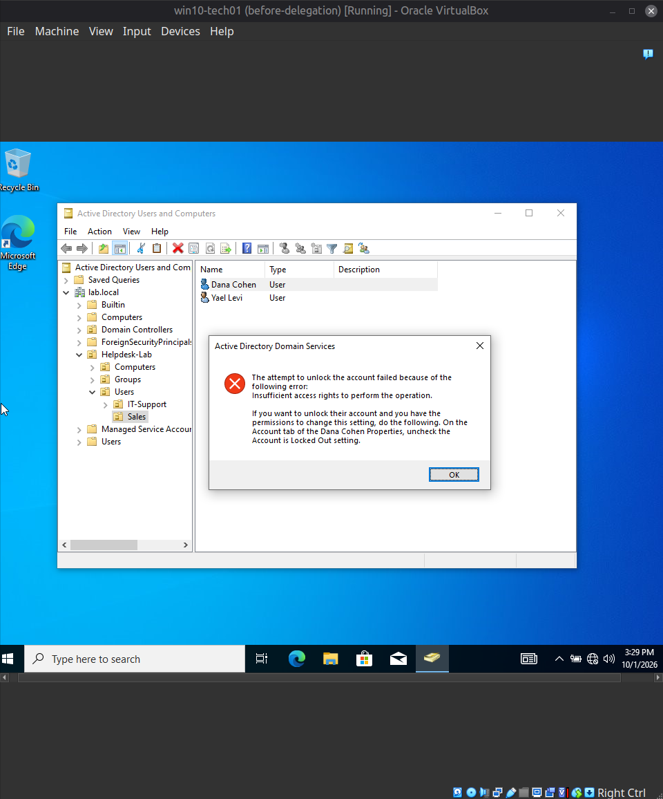
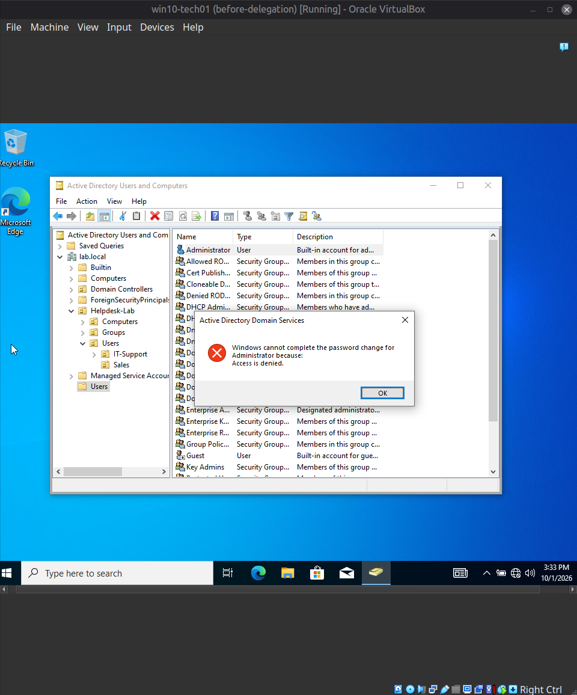

[Home](../../README.md) · [Windows domain](../README.md)

# Scenario 7: Helpdesk technician cannot reset a password (least-privilege delegation)

| | |
|---|---|
| **Reported** | "I forgot my password and I'm locked out. I called IT and Omer says he can't reset it for me. He gets an access error." |
| **Root cause** | The `GG-IT-Support` group had no permission to reset passwords on Sales users. |
| **Fix** | Delegated password-reset and unlock rights on the Sales OU to `GG-IT-Support`, then tested an allowed action and refused ones. |
| **Evidence** | The "Access is denied" message, the Effective Access tab, and the refusal on the `Administrator` account. |

**Setup (AD deep-dive, stage D).** `win10-tech01` was prepared as a technician workstation
so the permission checks would reflect what a technician sees from their own machine:
- Snapshot `before-delegation` taken first.
- RSAT (AD DS and AD LDS tools) installed through Settings → Optional features, with the
  adapter temporarily switched to NAT for internet access and then returned to the
  internal network `LAB-INT`.
- Machine joined to `lab.local`. After a restart, `otech` (a member of `GG-IT-Support`,
  not a domain admin) signed in, and `whoami` returned `lab\otech`.

**Ticket:**
> Reporter: Dana Cohen (dcohen)
> Symptom: "I forgot my password and I'm locked out. I called IT and Omer says he can't
> reset it for me. He gets an access error."

**Fault (a missing permission):** no delegation existed for `GG-IT-Support`.

**Diagnostic path:**
1. Reproduced it as `otech` on `win10-tech01`, in Active Directory Users and Computers:
   Reset Password on Dana Cohen returned "Windows cannot complete the password change for
   Dana Cohen because: Access is denied."
2. On the DC, with Advanced Features enabled, Properties → Security → Advanced →
   Effective Access on Dana's account (evaluated for the technician account) showed
   *Reset password* denied while *Change password* was allowed. *Change password* requires
   knowing the old password, so it does not help a user who has forgotten theirs.
3. Considered the shortcut of adding Omer to Domain Admins, which would make the error go
   away but grants far more than the task needs, and chose delegation instead.

**Root cause:** `GG-IT-Support` had no permission to reset passwords on Sales user objects.

**Resolution:** two delegations on the `Sales` OU, granted to the group `GG-IT-Support`
rather than to Omer personally:
1. Delegation of Control wizard, common task *Reset user passwords and force password
   change at next logon*.
2. A second wizard run, custom task, User objects, property-specific *Read lockoutTime*
   and *Write lockoutTime* (the permission needed to unlock an account; per the
   documentation consulted, the single common task does not cover it).

**What happened between the two:** after the first delegation, retrying Reset Password
produced a different error, "The attempt to unlock the account failed because of the
following error: Insufficient access rights to perform the operation." That showed the
reset permission was working but the unlock was not yet permitted. It was not checked
whether the password itself had already changed during that attempt. After the second
delegation the retry completed, and Active Directory Users and Computers reported that the
password had been changed.

**Verification, in both directions:**
- Allowed: password reset on Dana Cohen (a Sales user) succeeded after both delegations.
- Refused: as `otech`, Reset Password on the built-in `Administrator` account (in the
  default Users container, outside `Sales`) returned "Access is denied". Setting *Account
  is disabled* on a Sales user was also refused (this one is reported, not captured in a
  screenshot).

**Not tested:** unlocking a freshly locked account as `otech` was skipped by choice, so the
evidence for the unlock permission is indirect (the unlock error stopped once the
lockoutTime permission was added). Account creation, deletion, and moving users were not
tried.

**Design notes:** the permissions went to a group, so a new technician gets them by being
added to `GG-IT-Support`; they apply to one OU, not the domain; and they cover two narrow
rights instead of an administrator role. The refusal on `Administrator` shows the scope
limit working.

**Screenshots**

*On `win10-tech01`, Active Directory Users and Computers appears in Start search after RSAT is installed.*

*`whoami` on `win10-tech01` returns `lab\otech` after joining the domain.*

*Before delegation: resetting Dana Cohen's password as `otech` fails with "Access is denied".*

*Effective Access on Dana Cohen's account: *Reset password* is not granted, while *Change password* is.*

*After the first delegation, retrying the reset: "The attempt to unlock the account failed... Insufficient access rights".*

*As `otech`, resetting the built-in `Administrator` password is refused: "Access is denied".*

---

[← Previous: Scenario 6: GPO not applying (wrong OU)](06-gpo-not-applying-wrong-ou.md) · [Back to the Windows domain page →](../README.md)
